# Austin Animal Center Intakes in 2024
## Research Goal
This project uses 2024 Austin Animal Center (AAC) intake and outcome records to study patterns in stray-animal intake and shelter outcomes. 
We examine whether these patterns differ by animal characteristics, whether stray intakes vary across found locations with different income and crime conditions, and whether weather is associated with intake and outcome patterns. During the analysis, we also identified animals that entered AAC more than once, so we further examined how repeat intakes occur and what happens afterward.
## Table of Contents
- [1. Research Questions and Analysis Modules](#1-research-questions-and-analysis-modules)
- [2. Data Source](#2-data-source)
- [3. Methodology](#3-methodology)
- [4. Main Findings](#4-main-findings)
- [5. Limitations](#5-limitations)
- [6. Extensions](#6-extensions)
- [7. Reproducing the Project](#7-reproducing-the-project)

## 1. Research Questions and Analysis Modules

This project examines stray-animal intakes at the Austin Animal Center in 2024 from five complementary perspectives. Each analysis module focuses on a different part of the intake process or the broader environment in which stray animals are found.

| Analysis Module | Main Research Question | Detailed Analysis |
|---|---|---|
| **Repeat Intakes** | How common are repeat intakes, how quickly do animals return, what are the most common return pathways, and what happens after they return? | [Repeat Intake Analysis](artifacts/README/README-repeat-intake-analysis.md) |
| **Basic Analysis** | How do cat and dog intake profiles, monthly patterns, locations, and recorded outcomes differ, and how do adoption shares vary by age, sex, breed, and color? | [Basic Analysis](artifacts/README/README-basic-analysis.md) |
| **Income & Found Location** | How do stray-animal intake patterns vary across areas with different income levels, and are animals found in different socioeconomic areas associated with different intake or outcome patterns? | [Income and Location Analysis](artifacts/README/README-income.md) |
| **Crime & Found Location** | Do areas with higher reported crime counts also tend to have more stray-animal intakes, and does this relationship remain after accounting for geographic and monthly differences? | [Crime and Location Analysis](artifacts/README/README-crime.md) |
| **Weather** | How are precipitation and temperature associated with AAC intake volume, intake and outcome composition, and differences between dogs and cats? | [Weather Data](code/weather/README.md)<br>[Weather Analysis](code/weather_analysis/README.md) | 

> **Note:** This README is a condensed summary of the overall project.  
More detailed methods, results, figures, limitations, and reproduction steps are available in the README for each analysis module.
## 2. Data Source
The project uses Austin Animal Center intake and outcome records as the core data for all analysis modules. Additional external datasets are introduced only when needed for the income, weather, and crime analyses.

### 2.1 Core Austin Animal Center Data

#### 2.1.1 Austin Animal Center Intakes

**Source:** [City of Austin Open Data](https://data.austintexas.gov/Health-and-Community-Services/Austin-Animal-Center-Intakes-10-01-2013-to-05-05-2/wter-evkm/about_data)

The intake dataset records individual animal intake events at Austin Animal Center. It serves as the primary dataset for all five analysis modules.

**Important fields include:**

- Animal ID
- DateTime
- Found Location
- Intake Type
- Intake Condition
- Animal Type
- Sex upon Intake
- Age upon Intake
- Breed
- Color

#### 2.1.2 Austin Animal Center Outcomes

**Source:** [City of Austin Open Data](https://data.austintexas.gov/Health-and-Community-Services/Austin-Animal-Center-Outcomes-10-01-2013-to-05-05-/9t4d-g238/about_data)

The outcome dataset records how and when animals leave Austin Animal Center. It is used together with the intake data to study shelter outcomes and repeat-intake histories.

**Important fields include:**

- Animal ID
- DateTime
- Outcome Type
- Outcome Subtype
- Animal Type
- Sex upon Outcome
- Age upon Outcome
- Breed
- Color

The intake and outcome datasets are linked using `Animal ID` and `DateTime` when an analysis requires intake–outcome matching.

#### 2.1.3 Geocoded Found Locations

**Source:** [City of Austin COA Locator](https://maps.austintexas.gov/arcgis/rest/services/Geocode/COA_Locator/GeocodeServer)

AAC `Found Location` values are matched to geographic coordinates. Only records that pass the matching checks are saved to `data/processed/aac_intakes_clean_geocoded.csv`, a separate subset of the cleaned intake records.

The script uses numbered addresses and intersections. Accepted matches require matched status, a locator score of at least 95, a supported match type, consistent address components, and valid WGS84 coordinates within the study-area bounds. The score is not a probability of accuracy. The saved file contains 7,545 of 11,815 intake events; this is a selected subset, so non-spatial summaries use the full cleaned data.

The derived geographic fields are:

- `latitude`
- `longitude`
- `location_precision` (match type, such as an address point or street intersection)

These coordinates are used by the Basic Analysis maps and the income and crime analyses. Each module then converts the coordinates into the geographic unit required for that specific analysis.

### 2.2 Additional Data for Income

#### American Community Survey (ACS)

**Source:** [2024 ACS 5-Year, Table B19013](https://data.census.gov/table/ACSDT5Y2024.B19013)

The analysis uses Census-tract median household income from Table B19013.

**Important variables include:**

- `B19013_001E` — Median Household Income
- `B19013_001M` — Margin of Error
- Census tract `GEOID`

#### 2024 TIGER/Line Census Tract Boundaries

**Source:** [2024 TIGER/Line Texas Census Tracts](https://www2.census.gov/geo/tiger/TIGER2024/TRACT/tl_2024_48_tract.zip)

The tract polygons are used to assign geocoded AAC intake locations to Census tracts before joining income data.

### 2.3 Additional Data for Crime

#### Austin Police Department Crime Reports 2024

**Source:** [City of Austin Open Data](https://data.austintexas.gov/d/hbc5-hmey)

Reported crime incidents are obtained through the City of Austin Socrata API.

**Important fields include:**

- incident_report_number
- occ_date
- council_district

Each incident ID is counted once in the analysis.

#### City of Austin Council District Boundaries

**Source:** [City of Austin ArcGIS REST Service](https://maps.austintexas.gov/arcgis/rest/services/Shared/BoundariesGrids_2/MapServer/0)

Official council-district polygons are used to convert the geocoded AAC intake locations into the geographic unit used by the crime analysis.

Conceptually:

```text
AAC Found Location
        ↓
Latitude / Longitude
        ↓
Council District
        ↓
Crime Count by District and Month
```


### 2.4 Additional Data for Weather Analysis

#### NOAA Daily Weather Observations

**Source:** [NOAA NCEI Daily Summaries API](https://www.ncei.noaa.gov/support/access-data-service-api-user-documentation)

NOAA provides daily weather observations for Austin. The current analysis uses observations from station `USW00013958`.

**Important variables include:**

- TMAX — daily maximum temperature
- TMIN — daily minimum temperature
- PRCP — daily precipitation

#### Open-Meteo Historical Weather Data

**Source:** [Open-Meteo Historical Weather API](https://open-meteo.com/en/docs/historical-weather-api)

Open-Meteo provides additional daily weather measures used in the analysis.

**Important variables include:**

- relative_humidity_2m_mean
- cloud_cover_mean
- wind_speed_10m_max

The NOAA and Open-Meteo datasets are standardized and merged by calendar date, then matched with AAC intake and outcome records by event date.
## 3. Methodology

### 3.1 Repeat-Intake Analysis
The repeat-intake analysis combines the cleaned 2024 AAC intake and outcome records into an episode-level dataset.

For each animal, intake events are ordered chronologically and assigned unique intake-event identifiers. Outcomes are then matched to the most recent preceding intake using `pandas.merge_asof()`. If multiple outcomes are matched to the same intake episode, only the earliest outcome is retained. Intake episodes without a matched outcome are kept in the dataset.

A repeat intake is defined as a new intake that occurs after the animal previously left AAC through one of the following outcome types:

- `Adoption`
- `Return to Owner`
- `Rto-Adopt`
> Notes: Rto-Adopt is an AAC outcome category related to returning an animal to its owner through an adoption process. AAC reports it together with Return to Owner, but we keep it as a separate recorded category in our analysis.

Returns following `Transfer` or other outcome types are excluded from the main repeat-intake definition because those records may represent movement between organizations rather than a return from the community.

The analysis measures the share of repeat-intake episodes, time until return, return pathways, outcomes after return, and the number of observed intake episodes per animal.

### 3.2 Basic Analysis

The basic analysis compares cats and dogs using cleaned 2024 AAC records, covering all recorded intake types. It addresses six questions:

1. **Intake profiles:** Compare age, sex, and breed distributions.
2. **Monthly patterns:** Count intakes by month and species, with an age breakdown for cats.
3. **Intake types and conditions:** Compare how animals arrived and their recorded conditions.
4. **Outcome composition:** Compare the shares of adoption, transfer, return to owner, and other outcomes.
5. **Adoption shares by characteristics:** Compare adoption shares across age, sex, breed, and color groups recorded at outcome.
6. **Intake locations:** Map geocoded intake counts and check how removing the shelter's own address changes the pattern.

Composition percentages use all intake or outcome records for each species. Adoption shares use all outcome records within each species and trait group, including blank outcomes; `Rto-Adopt` is separate from `Adoption`. Intakes and outcomes are analyzed separately as events, not as a matched group of animals. Only the maps use the geocoded subset.


### 3.3 Income-Level
The income analysis combines geocoded 2024 AAC stray cat and dog intake records with Census-tract household-income data.

The team's existing latitude and longitude coordinates are spatially matched to 2024 TIGER/Line Census tract boundaries. Median household income is obtained from the 2024 ACS 5-Year Table B19013 and joined using each tract's 11-digit `GEOID`.

The analysis uses **one intake event as the observation unit**. It keeps records that:

- occurred in 2024,
- have `Intake Type == "Stray"`,
- are cats or dogs,
- can be matched to a Census tract with numeric income information,
- are not records referring to the AAC shelter address at `7201 Levander`.

After these filters, the analysis contains **5,990 intake events across 269 observed Census tracts**.

The 269 observed tracts are divided into **Low, Middle, and High income groups** using tract-level median household income. Each tract receives equal weight when the income cutoffs are created, rather than weighting tracts by their number of AAC intake events.

The analysis then compares:

- stray-intake counts,
- cat and dog composition,
- age composition within species,
- recorded shelter outcomes,
- return-to-owner shares for cats and dogs.

These comparisons are descriptive and do not estimate the causal effect of neighborhood income on animal intake or shelter outcomes.

### 3.4 Crime
The crime analysis combines 2024 Austin crime reports with geocoded AAC stray-intake records at the council-district level.

Reported crime incidents are obtained through the City of Austin Socrata API, while official council-district boundaries are downloaded through the City of Austin ArcGIS REST API. AAC records are restricted to `Stray` intakes, and observations referring to the shelter's own `7201 Levander` address are removed.

Each geocoded AAC intake is spatially matched to one official council-district polygon. Crime incidents and matched stray intakes are then counted separately by district and month, producing a complete dataset of 10 council districts × 12 months.

The analysis compares crime and stray-intake counts using:

- annual across-district correlations,
- unadjusted district-month regressions,
- regressions controlling for district and month differences,
- monthly daily-average trends.

These results are interpreted as descriptive associations rather than causal effects.


### 3.5 Weather
The weather analysis combines cleaned 2024 Austin Animal Center (AAC) intake and outcome records with daily Austin weather observations from NOAA and Open-Meteo. NOAA provides daily maximum temperature, minimum temperature, and precipitation observations from station `USW00013958`, while Open-Meteo provides daily mean relative humidity, mean cloud cover, and maximum wind speed for the selected Austin coordinates.

The two weather datasets are standardized and merged one-to-one by calendar date to construct `austin_weather_2024.csv`. The processed dataset is validated for complete 2024 date coverage, duplicate dates, missing values, and consistency of weather measurements and indicators. AAC intake and outcome events are subsequently matched to the corresponding daily weather observations using their event dates.

Weather conditions are classified using daily precipitation and temperature:

- **Wet days:** Daily precipitation greater than 0 mm; dry days have zero precipitation.
- **Hot days:** Daily maximum temperature at least 35°C.
- **Cold days:** Daily minimum temperature at most 5°C.
- **Freezing days:** Daily minimum temperature at most 0°C.

Days not meeting each temperature threshold form the corresponding reference group.

The analysis uses four complementary approaches:

1. **Daily intake volume.** Intake events are aggregated into daily counts, and mean daily intakes are compared between wet and dry days. The main comparison includes 365 days with recorded intake activity, excluding December 25, 2024, for which no intake records are available. A sensitivity analysis additionally treats this missing date as a zero-intake day.

2. **Selected intake and outcome proportions.** The proportion of `Stray` intakes is compared between wet and dry days, while the proportion of `Adoption` outcomes is compared between hot and non-hot days. Both proportions are calculated from event counts within each weather group.

3. **Animal-type heterogeneity.** The daily intake, stray intake, and adoption outcome comparisons are repeated separately for dogs and cats. For daily counts, both animal types are evaluated over the same 365 recorded intake dates, assigning zero to an animal type on dates when AAC recorded intakes but none for that type. Stray and adoption proportions are calculated separately within each animal-type and weather group.

4. **Full event composition.** The analysis compares all six recorded intake types, all 16 intake conditions, and all nine non-missing outcome types across rainfall, extreme heat, cold weather, and freezing-day conditions. For each category, its share is calculated relative to all eligible intake or outcome events in the corresponding weather group.

Differences in category shares are reported in **percentage points**, calculated as the weather-exposed group's percentage minus the reference group's percentage. The extended composition analyses produce category-level summary tables and visualizations, including three heatmaps consolidating the four weather comparisons.

All weather-event matches are validated, and the analyses distinguish daily intake counts from event-level proportions. The results describe observed associations rather than causal effects, since weather conditions may coincide with seasonal variation, shelter operations, and other factors affecting recorded shelter activity.


## 4. Main Findings
### 4.1 Repeat Intakes

Repeat intakes were relatively uncommon in the 2024 AAC data. Repeat-intake episodes accounted for about **4.4% of all intake episodes**, while about **4.1% of unique animals** experienced at least one qualifying repeat intake.


Most observed returns happened relatively quickly. About **86.9% of qualifying repeat intakes occurred within 90 days** of the previous outcome, and more than **72% occurred within the first 30 days**.


The most common return pathway was **Adoption → Owner Surrender**, which accounted for approximately **71.0% of qualifying repeat-intake episodes**. After a repeat intake, **70.6%** of episodes were followed by another adoption.
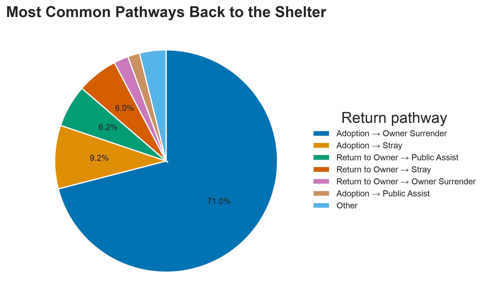

Most repeat-intake animals returned only once during 2024: about **89%** had exactly two observed intake episodes.


### 4.2 Basic Analysis

The six themes below summarize the main differences between cat and dog records. Click any figure to view it at full size.

<table>
  <tr>
    <td width="50%" valign="top">
      <p><strong>Intake Profiles</strong></p>
      <a href="artifacts/basic_analysis/figures/01_intake_profile/age_distribution.png">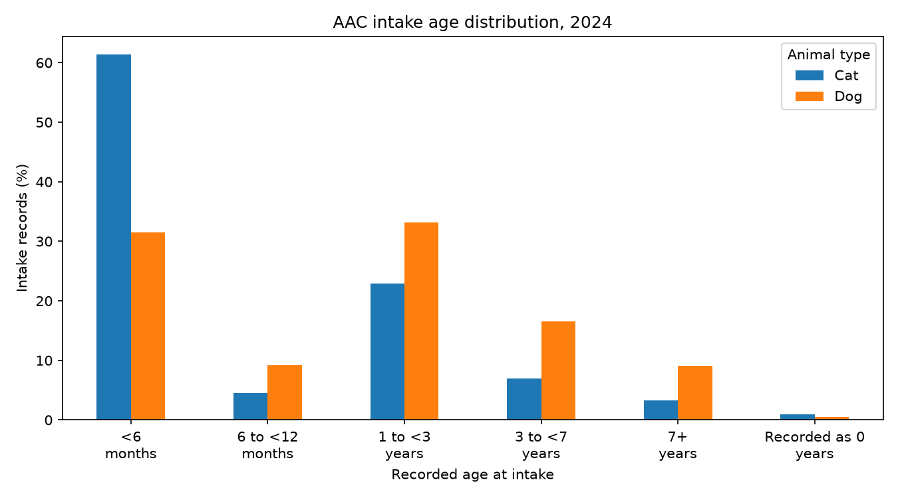</a>
      <p>Cats have a younger intake profile: <strong>61.4%</strong> of cat records report an age under six months, compared with <strong>31.5%</strong> of dog records.</p>
    </td>
    <td width="50%" valign="top">
      <p><strong>Monthly Intake Patterns</strong></p>
      <a href="artifacts/basic_analysis/figures/02_intake_timing/monthly_intakes.png">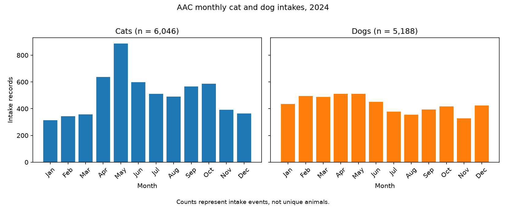</a>
      <p>Cat intakes peak in <strong>May (887)</strong>, with cats under six months accounting for <strong>73.6%</strong> of that month's records. Dog intakes peak in <strong>April and May (512 each)</strong>.</p>
    </td>
  </tr>
  <tr>
    <td width="50%" valign="top">
      <p><strong>Intake Types and Conditions</strong></p>
      <a href="artifacts/basic_analysis/figures/03_intake_context/intake_type.png">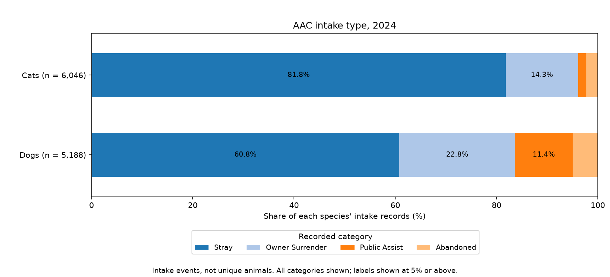</a>
      <p><strong>Stray</strong> is the most common intake type for cats (<strong>81.8%</strong>) and dogs (<strong>60.8%</strong>). Owner surrender accounts for a larger share of dog intakes (<strong>22.8% versus 14.3%</strong>).</p>
    </td>
    <td width="50%" valign="top">
      <p><strong>Outcome Composition</strong></p>
      <a href="artifacts/basic_analysis/figures/04_outcome_profile/outcome_distribution.png">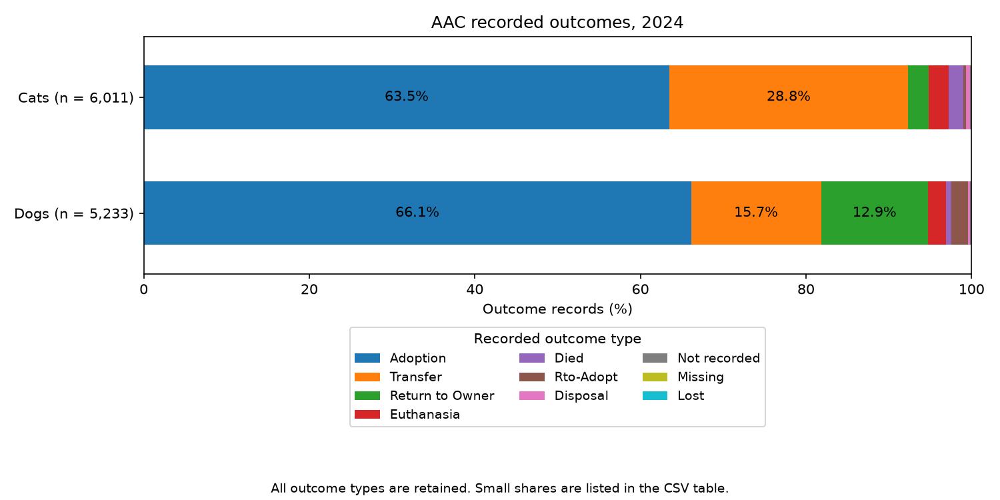</a>
      <p>Adoption accounts for <strong>63.5%</strong> of cat outcomes and <strong>66.1%</strong> of dog outcomes. Cats have a higher transfer share, while dogs have a higher return-to-owner share.</p>
    </td>
  </tr>
  <tr>
    <td width="50%" valign="top">
      <p><strong>Adoption Shares by Characteristics</strong></p>
      <a href="artifacts/basic_analysis/figures/05_trait_comparisons/adoption_by_age.png">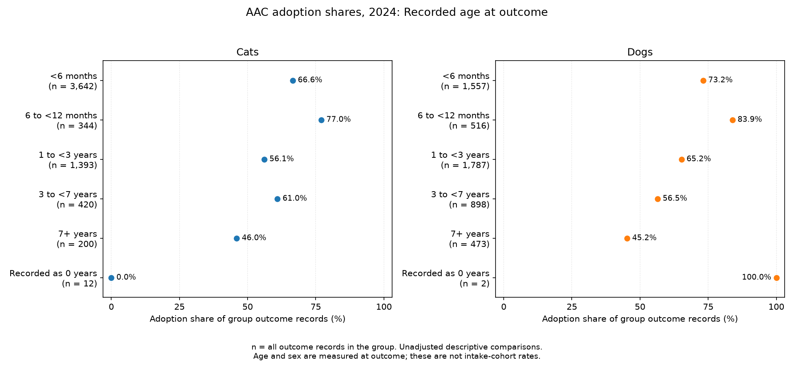</a>
      <p>Among the five defined age bands, animals aged <strong>6 to under 12 months at outcome</strong> have the highest adoption shares: <strong>77.0% for cats</strong> and <strong>83.9% for dogs</strong>. Records labeled <code>0 years</code> are kept separate.</p>
    </td>
    <td width="50%" valign="top">
      <p><strong>Recorded Intake Locations</strong></p>
      <a href="artifacts/basic_analysis/figures/06_intake_locations/intake_locations_all_records.png">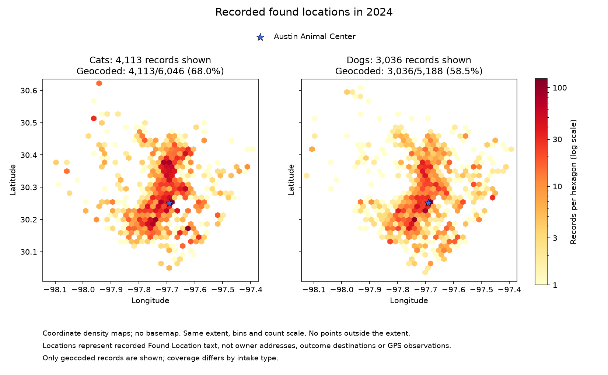</a>
      <p>The maps cover <strong>68.0%</strong> of cat intakes and <strong>58.5%</strong> of dog intakes. Coverage varies by intake type, so the maps show only part of the recorded intake activity.</p>
    </td>
  </tr>
</table>

These comparisons describe recorded events, not causal effects or an individual animal's eventual adoption probability. The full report includes the remaining trait comparisons and the map excluding the shelter's address.


### 4.3 Income
The income analysis includes **5,990 eligible stray cat and dog intake events across 269 observed Census tracts**.

The Low- and Middle-income groups had similar numbers of recorded stray intakes, with **2,458** and **2,528** events, respectively, while the High-income group had substantially fewer, with **1,004** events.

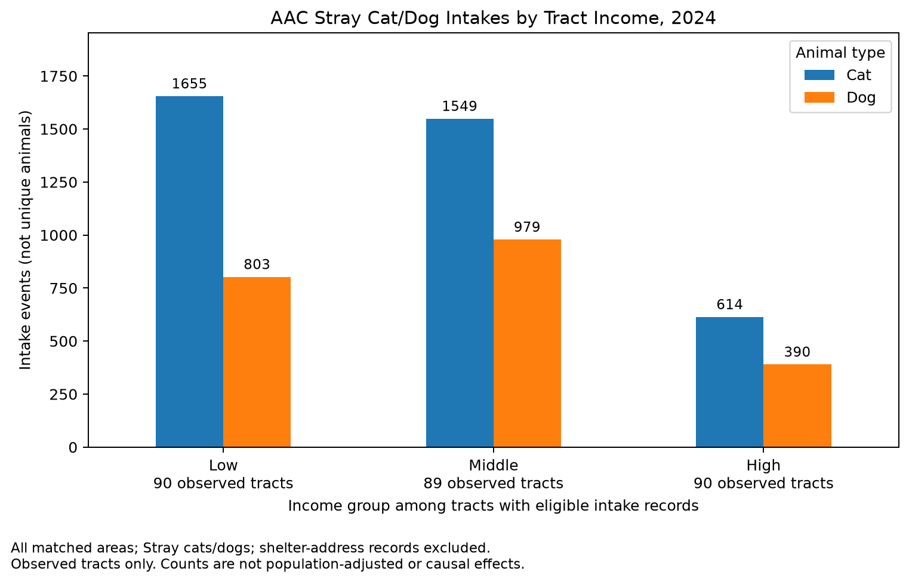

However, these are **raw intake counts rather than population-adjusted rates**, so the lower count in higher-income tracts should not be interpreted as evidence that higher-income areas necessarily have fewer stray animals.

Species composition also differed across income groups. Cats accounted for **67.33%** of eligible intakes in the Low-income group, compared with about **61%** in both the Middle- and High-income groups. Age composition, however, showed relatively small differences across income groups within each species.

Recorded outcomes did not show a simple monotonic relationship with income. Adoption was the most common outcome in every income group, but its share was highest in the Middle-income group at **63.34%**, compared with **59.00%** in Low-income tracts and **58.36%** in High-income tracts.

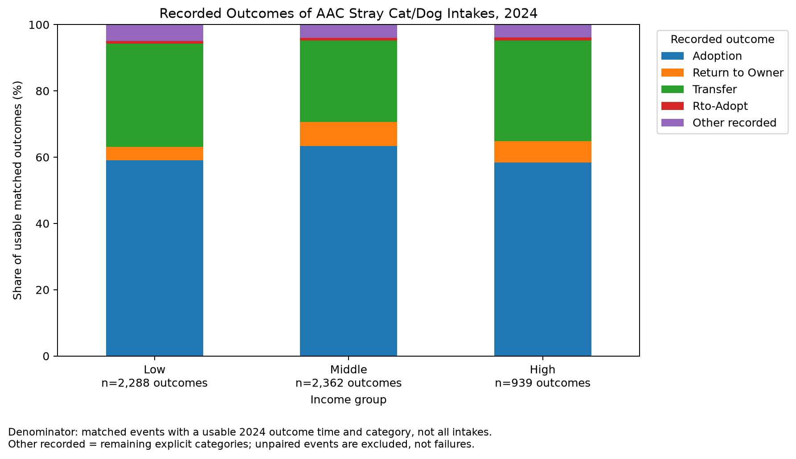

Return-to-owner patterns also differed strongly by species. Dogs had substantially higher RTO shares than cats in every income group. For dogs, the RTO share was **9.52%**, **14.80%**, and **12.39%** across the Low-, Middle-, and High-income groups, while the corresponding cat shares were **1.47%**, **2.78%**, and **3.04%**. 

Overall, the income analysis shows clear differences in the composition and outcomes of AAC stray-intake records across income groups, but the patterns are not consistently increasing or decreasing with income. The results should therefore be interpreted as descriptive neighborhood differences rather than a direct income effect.


### 4.4 Crime
### Crime and Stray Animal Intakes (Austin, 2024)

We combined Austin's 2024 reported crime data with geocoded **Austin Animal Center (AAC) stray intakes** at the City Council district level. Our district-by-month panel contains **120 observations** (10 districts × 12 months), covering **85,437 crime reports assigned to a council district** and **4,664 geocoded stray intakes matched to those districts**.

**Finding 1 — Positive cross-district association.** Across the 10 council districts, annual crime counts and stray intake counts are positively correlated (**Pearson r = 0.618; p = 0.057**). This relationship does **not** meet the conventional 5% statistical significance threshold.

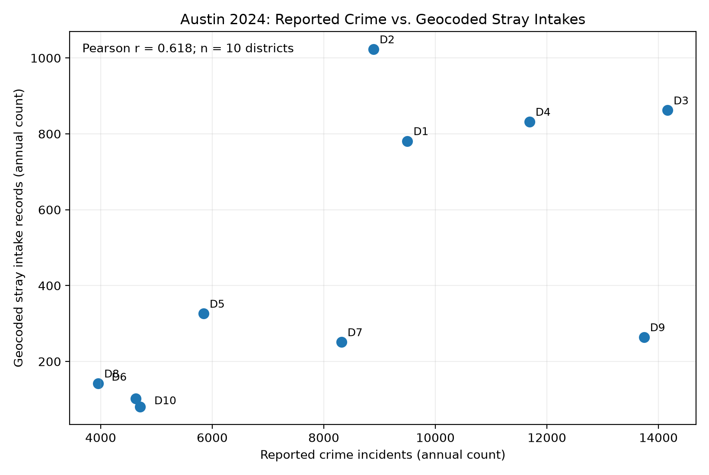

*Figure 1. Annual crime reports and matched stray intakes across Austin's 10 City Council districts.*

**Finding 2 — The association weakens after accounting for district and month differences.** In a district-month OLS regression with **district and month fixed effects** and standard errors clustered by district, an additional 100 reported crimes is associated with an estimated **3.54 additional stray intakes** (**p = 0.403; 95% CI: -5.58 to 12.66**). The estimate is not statistically distinguishable from zero.

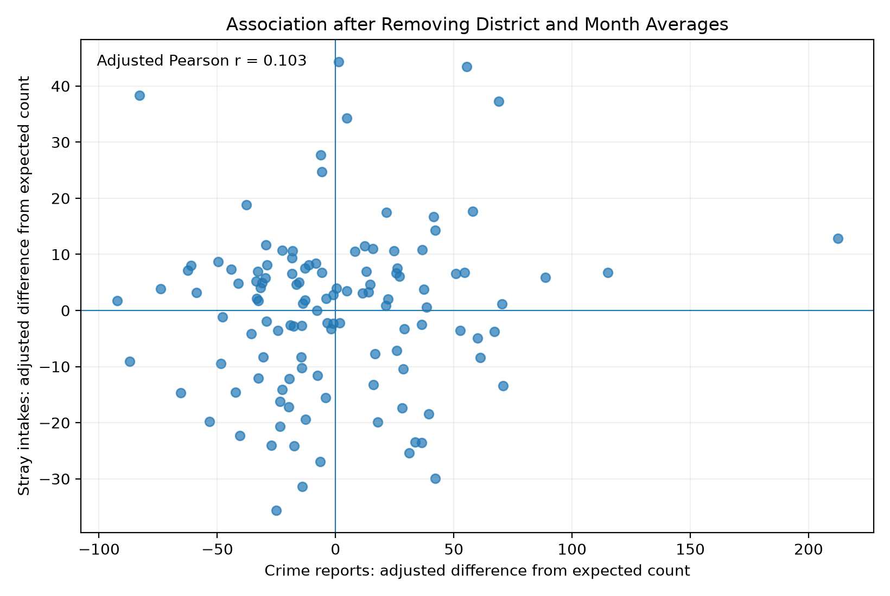

*Figure 2. Crime and stray-intake relationship after adjusting for district and month effects.*


### 4.5 Weather
The weather analysis reveals several descriptive differences in Austin Animal Center (AAC) intake and outcome patterns across rainfall and temperature conditions during 2024. The findings cover daily intake volume, stray intake and adoption outcome proportions, differences between dogs and cats, and the broader composition of intake and outcome events.

**Rainfall and Daily Intake Volume.** Average daily intake counts were **32.57 on dry days** and **31.56 on wet days**, a difference of approximately **1.01 fewer intake events per day on wet days**. The difference was relatively small compared with the variation in daily intake counts within each group. Treating the one date without recorded intakes as a zero-intake day did not change the direction of this comparison.

**Rainfall and Stray Intake Proportions.** Stray intakes represented **68.90% of intake events on dry days**, compared with **72.01% on wet days**, a **3.11-percentage-point increase**. Thus, although the average daily intake count was slightly lower on wet days, stray animals accounted for a larger share of recorded intakes.

**Extreme Heat and Adoption Outcome Proportions.** Adoptions represented **61.95% of valid outcome events on non-hot days** and **65.11% on hot days**, a **3.16-percentage-point increase**. This measures the composition of recorded shelter outcomes, not the probability that an individual animal entering AAC will eventually be adopted.

**Animal-Type Heterogeneity.** Separate comparisons for dogs and cats reveal that the aggregate weather-related patterns are not uniform across animal types.

- **Daily intake volume:** Average daily dog intakes decreased from **14.31 on dry days to 13.81 on wet days**, while average daily cat intakes decreased from **16.60 to 16.43**. Both differences were modest.
- **Stray intake proportions:** The stray share increased from **60.01% to 64.19% for dogs** (**+4.18 percentage points**) but from **81.72% to 82.33% for cats** (**+0.61 percentage points**). The wet-day increase was therefore more pronounced among dogs, although cats had a higher stray intake share under both weather conditions.
- **Adoption outcome proportions:** The adoption share increased from **65.83% to 67.28% for dogs** (**+1.45 percentage points**) and from **61.65% to 67.20% for cats** (**+5.55 percentage points**) between non-hot and hot days. The hot-day difference was substantially larger among cats.


These findings suggest that aggregate weather comparisons can conceal meaningful descriptive differences between animal groups.

**Intake Type Composition (Q5).** Extending the analysis to all six intake types reveals differences across rainfall, heat, cold, and freezing conditions. The `Stray` share was **3.11 percentage points higher on wet days** but **11.12 percentage points lower on cold days**. On cold days, `Owner Surrender` and `Public Assist` represented larger shares of intake events, increasing by **6.53** and **3.22 percentage points**, respectively. In contrast, the stray intake share was nearly identical between hot and non-hot days.

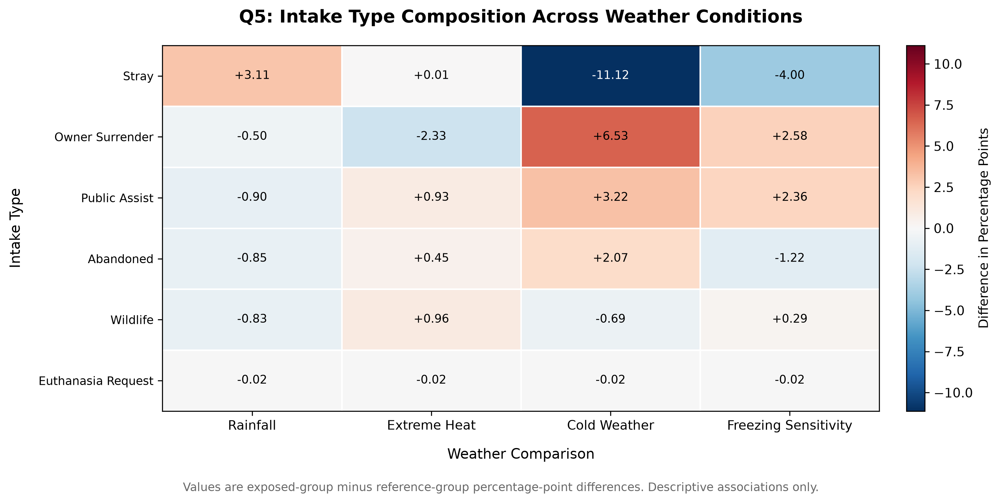

**Intake Condition Composition (Q6).** The distribution of recorded intake conditions was broadly similar between wet and dry days, but more noticeable differences appeared under extreme heat. On hot days, the share of intakes classified as `Normal` was **6.12 percentage points lower**, while the shares classified as `Sick` and `Neonatal` were **2.54** and **2.30 percentage points higher**, respectively, compared with non-hot days.

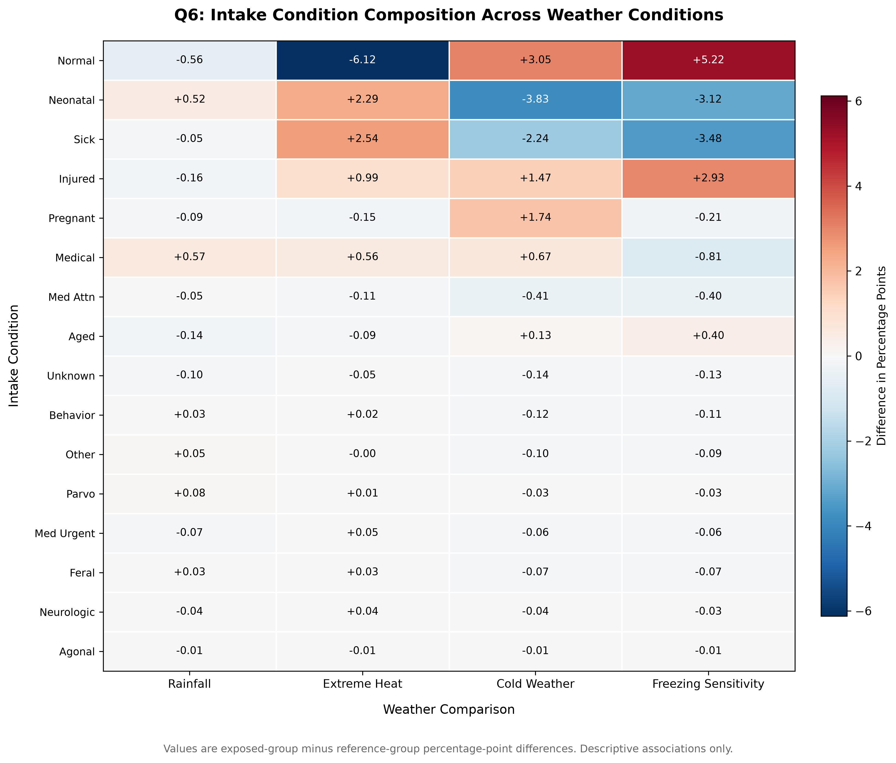

**Outcome Type Composition (Q7).** Across the nine non-missing outcome categories, the adoption share was higher in the weather-exposed group in all four comparisons: **+1.21 percentage points on wet days**, **+3.16 on hot days**, **+4.02 on cold days**, and **+6.38 on freezing days**, relative to their respective reference groups. On cold days, the `Transfer` share was also **5.63 percentage points lower** than on non-cold days. The freezing-day results require particular caution because they are based on only **185 valid outcome events**.

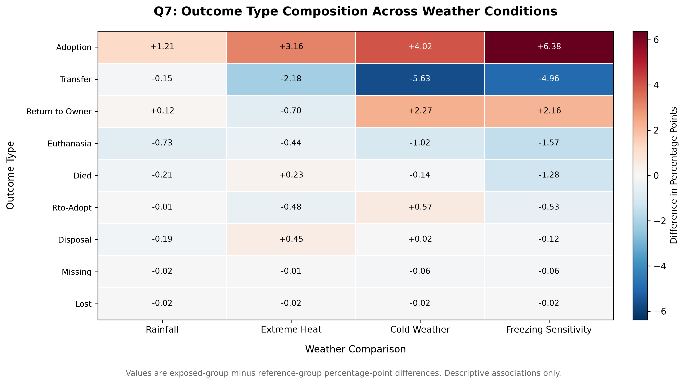

**Overall Interpretation.** Weather conditions are associated with differences in AAC intake volume, intake composition, recorded intake conditions, and outcome composition. These relationships vary across weather indicators and animal types. Rainfall-related differences in daily intake volume were modest, while some temperature-related differences in event composition were more pronounced.

All findings are **descriptive rather than causal**. Seasonal variation, shelter operations, differences in weather-group sample sizes, and other unobserved factors may contribute to the observed patterns.


## 5. Limitations
This project has several important limitations.
1. The main analysis is limited to 2024.
   Events occurring before or after the study period may not be captured. For example, an animal may have entered AAC before 2024 or had an outcome after 2024.
2. AAC data do not represent all stray animals in Austin.
   The datasets include animals that entered the Austin Animal Center system. Animals handled by other organizations, reunited with owners without entering AAC, or remaining outside the shelter system are not observed.
3. Some important behavioral information is unavailable.
   The datasets generally do not include detailed owner identity, reasons for surrender or return, or the motivations behind adoption decisions.
4. Found-location data are incomplete or imprecise for some animals.
   Some Found Location records cannot be reliably mapped to a specific Census geography, reducing the sample available for neighborhood-level analysis.
5. Neighborhood-level relationships are descriptive.
   Associations between income, crime, weather, and animal intake patterns should not be interpreted as causal effects.
6. Weather conditions are classified using binary thresholds, which simplify continuous variation in temperature and precipitation. The hot, cold,       and freezing indicators are evaluated in separate comparisons rather than as mutually exclusive weather categories. In the 2024 data, no days are     classified as both hot and cold or as both hot and freezing. However, all seven freezing days are also classified as cold days because the            freezing threshold is more restrictive. Therefore, the freezing-day results should be interpreted as a sensitivity analysis of the cold-weather       findings rather than independent evidence.
7. Weather comparisons do not fully account for seasonal variation, concurrent weather conditions, or differences in the timing and location of          animal exposure. Daily weather observations may not reflect the conditions experienced by individual animals before intake or outcome events. In      addition, the small number of freezing days limits the reliability and generalizability of comparisons involving freezing conditions.
## 6. Extensions
This project could be extended in several directions:
1. Use multiple years of AAC intake and outcome data.
   A longer time period would provide more complete animal histories and allow long-term trends to be studied.
2. Improve geographic matching.
   Better address cleaning or alternative geocoding methods could increase the share of Found Location records matched to Census geography.
3. Include additional socioeconomic variables.
   Future work could consider renter share, poverty rates, housing characteristics, or other neighborhood variables in addition to income.
4. Use richer animal-history data.
   More detailed owner information, surrender reasons, or adoption-history information would allow stronger interpretation of repeat-intake patterns.
5. Include animals outside the AAC system.
   Data from other shelters or animal-service organizations could provide a more complete picture of stray animals in the Austin area.
6. Study changes over time.
   Multi-year data could be used to examine whether intake patterns, neighborhood relationships, or repeat-intake rates have changed.
## 7. Reproducing the Project
### 7.1 Create and Activate a Virtual Environment
On macOS/Linux:
```
python3 -m venv .venv
source .venv/bin/activate
```
### 7.2 Install Dependencies
```
python -m pip install -r requirements.txt
```
### 7.3 Obtain the Raw Data
Place the raw AAC intake and outcome CSV files in:
```
data/raw
```
> Note: The raw data can be downloaded from the links above in [2.1 Core Austin Animal Center Data](#21-core-austin-animal-center-data), or you can use the copies already included in the `data/raw` folder.
### 7.4 Prepare the Shared AAC Data

Run the following commands from the repository root.

**Step 1: Clean the intake and outcome records.**

```bash
python code/data_cleaning/clean_aac_intake.py
python code/data_cleaning/clean_aac_outcomes.py
```

These scripts create:

```text
data/processed/aac_intakes_clean.csv
data/processed/aac_outcomes_clean.csv
```

**Step 2: Prepare the geocoded intake records.**

The repository already includes [data/processed/aac_intakes_clean_geocoded.csv](data/processed/aac_intakes_clean_geocoded.csv), used by the Basic Analysis maps and the income and crime analyses. This file is produced separately from the two cleaning scripts above. To regenerate it, run the geocoding script with an internet connection:

```bash
python code/data_cleaning/geocode_aac_intakes.py
```

Only records that pass the geocoding checks are saved to this separate file. The script preserves the original intake columns and adds the three geographic fields. If a complete local response cache is available, `--offline` rebuilds the file without network requests and stops if any required response is missing. The cache is not included in the repository.

The script also writes [geocoding_summary.csv](artifacts/geocoding/geocoding_summary.csv), which counts accepted records and the first exclusion reason for each remaining intake event. Its counts sum to all 11,815 input events, including 7,545 accepted events and 4,270 excluded events. Shares use all intake events as the denominator. Use `--summary` to choose another destination.

Matching rules, cache behavior, and checks: [Geocoding instructions](code/data_cleaning/README-geocoding.md).

### 7.5 Run the Analysis Modules
After the shared AAC datasets have been prepared, each analysis module can be run independently.
#### 7.5.1 Repeat Intake Analysis
Build the intake–outcome episode dataset and run the repeat-intake analysis:
```
python code/repeat_intakes_analysis/aac_in-out-episodes_2024.py
python code/repeat_intakes_analysis/repeat-intakes-analysis.py
```
These scripts create:
```
data/processed/aac_in-out-episodes_2024.csv
artifacts/repeat-intake-analysis/figures
```
#### 7.5.2 Basic Analysis

Run all six themes from the repository root:

```bash
python code/basic_analysis/run_analysis.py
```

The runner checks the three processed intake, outcome, and geocoded intake CSVs before starting any theme. Run `python code/basic_analysis/run_analysis.py --check-only` to check the inputs without writing figures or tables. The checks include required columns, 2024 dates, geocoded event correspondence, coordinates, and the shelter reference.

After the checks pass, the runner executes the themes in order and stops if one fails. It saves 14 PNG figures and 12 CSV tables under `artifacts/basic_analysis/`, with a separate folder for each theme. The numbered scripts can also be run individually.

Detailed instructions:
[Basic Analysis README](artifacts/README/README-basic-analysis.md#reproducing-the-analysis)

#### 7.5.3 Income Analysis
The income analysis uses the shared cleaned, geocoded, and episode-level AAC datasets together with the saved Census tract income and boundary files.

To rebuild the income-specific processed datasets and run the full analysis:

```
python code/income/clean_income.py
python code/income/merge_income.py
python code/income/analyze_income.py
python code/income/test_income.py
```
The analysis script generates the Income summary tables and figures under:
```
artifacts/income/
```
If the committed Income processed datasets are already available, the analysis can be reproduced directly with:
```
python code/income/analyze_income.py
python code/income/test_income.py
```
#### 7.5.4 Crime Analysis
Build the council-district-level crime and stray-intake datasets:
```
python code/crime/crime_component.py
```
It creates the main processed files:
```
data/processed/crime_stray_district_month_2024.csv
data/processed/crime_stray_district_2024.csv
```
Before running the full statistical analysis, you may verify the processed inputs without generating new outputs:
```
python code/crime/crime_analysis.py --check-only
```
Then run the full crime analysis:
```
python code/crime/crime_analysis.py
```
The analysis generates figures and statistical results under:
```
artifacts/crime/analysis/
```

#### 7.5.5 Weather Analysis
The weather analysis uses daily NOAA and Open-Meteo observations for Austin, Texas, covering January 1 through December 31, 2024. The two sources are combined into a processed daily weather dataset for subsequent analysis of Austin Animal Center intake and outcome events.

**Retrieve the raw weather data**

From the project root directory, run:

```bash
python3 code/weather/fetch_noaa.py
python3 code/weather/fetch_open_meteo.py
```

These scripts retrieve NOAA daily temperature and precipitation observations and Open-Meteo daily humidity, cloud cover, and wind speed data.

The raw data are saved to:

```text
data/raw/noaa_austin_2024.json
data/raw/open_meteo_austin_2024.json
```

**Process and validate the weather data**

After retrieving both datasets, run:

```bash
python3 code/weather/process_weather.py
```

The processing script standardizes the weather variables, merges the two sources by calendar date, constructs indicators for hot, freezing, and wet days, and validates the resulting dataset.

The processed dataset is saved to:

```text
data/processed/austin_weather_2024.csv
```

The resulting dataset contains 366 daily observations for 2024 and is used in the subsequent weather analysis.

If the processed weather dataset is already available, the data collection and processing steps can be skipped.

For further details on the data sources, variables, processing workflow, and validation procedures, see the [Weather Data README](code/weather/README.md).


**Run the weather analyses (Q1–Q7)**

Before running the analyses, ensure that the following three processed datasets are available:

```text
data/processed/austin_weather_2024.csv
data/processed/aac_intakes_clean.csv
data/processed/aac_outcomes_clean.csv
```

The weather dataset is generated using the data retrieval and processing steps described above. The cleaned AAC intake and outcome datasets are produced by the project's shared data-cleaning workflow.

Once all three datasets are available, run the following scripts from the project root directory:

```bash
python3 code/weather_analysis/analyze_daily_intakes.py
python3 code/weather_analysis/analyze_stray_intakes.py
python3 code/weather_analysis/analyze_adoption_outcomes.py
python3 code/weather_analysis/analyze_animal_type_heterogeneity.py
python3 code/weather_analysis/analyze_intake_type_composition.py
python3 code/weather_analysis/analyze_intake_conditions.py
python3 code/weather_analysis/analyze_outcome_type_composition.py
```

These seven scripts independently reproduce the analyses of daily intake counts (Q1), stray intake proportions (Q2), adoption outcome proportions (Q3), animal-type heterogeneity (Q4), intake type composition (Q5), intake condition composition (Q6), and outcome type composition (Q7). They can be run in any order once the required processed datasets are available.

The analyses generate summary tables and figures under:

```text
artifacts/weather_analysis/tables/
artifacts/weather_analysis/figures/
```

**Generate the summary heatmaps**

The summary heatmaps depend on the percentage-point difference tables generated by the Q5, Q6, and Q7 composition analyses. Therefore, run the heatmap script only after these three analyses have completed successfully:

```bash
python3 code/weather_analysis/make_summary_heatmaps.py
```

The resulting heatmaps are saved under:

```text
artifacts/weather_analysis/figures/summary_heatmaps/
```

For detailed methodology, validation checks, findings, and individual output files, see the [Weather Analysis README](code/weather_analysis/README.md).
