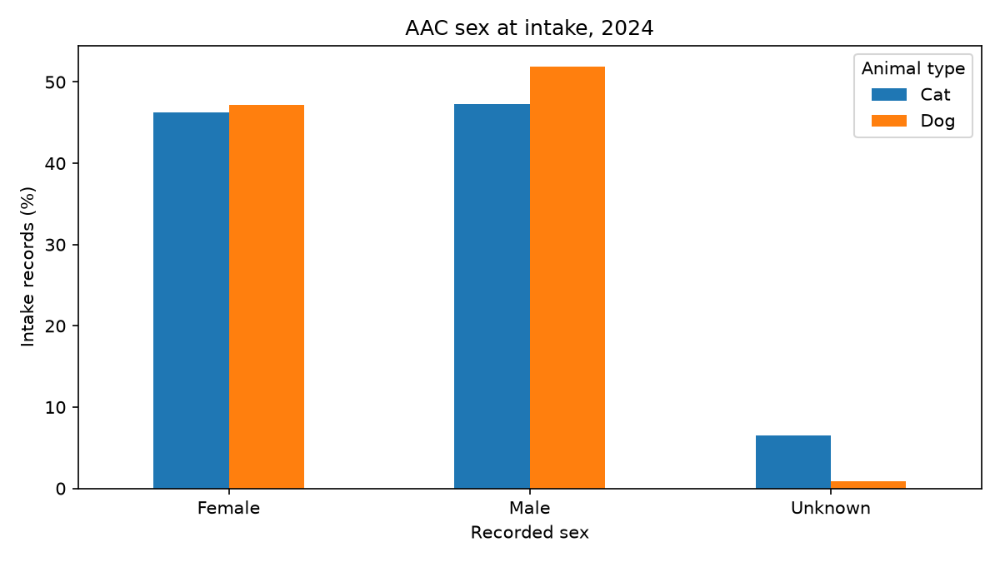
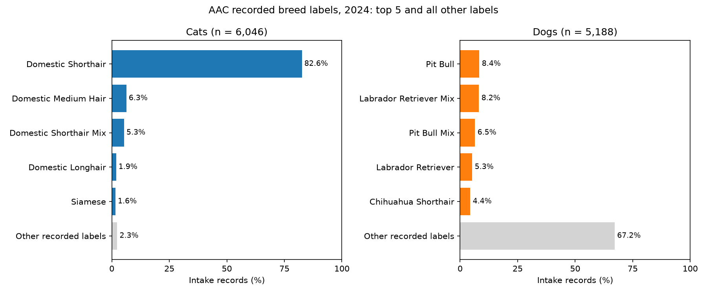
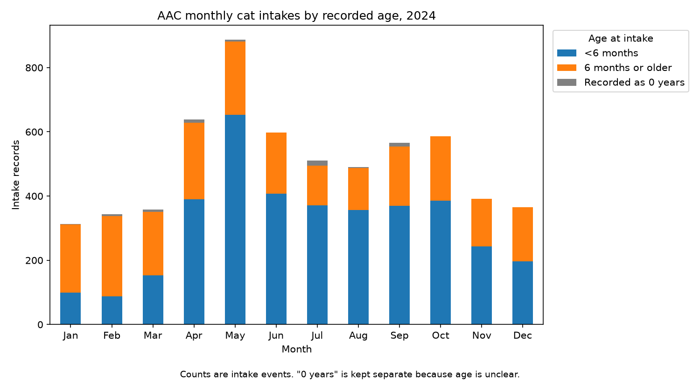
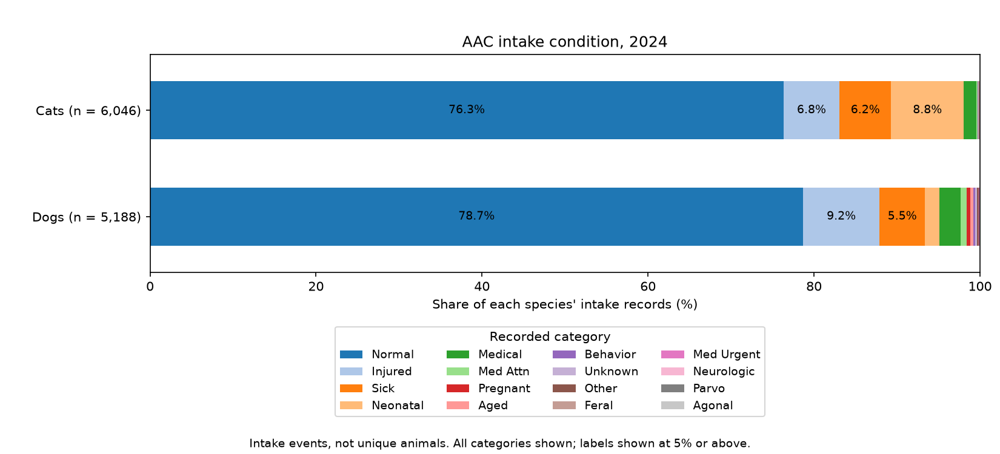
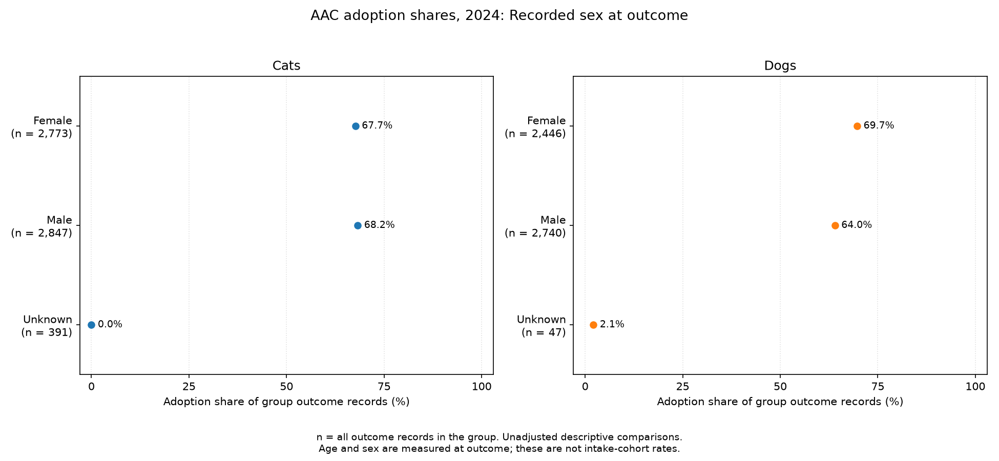
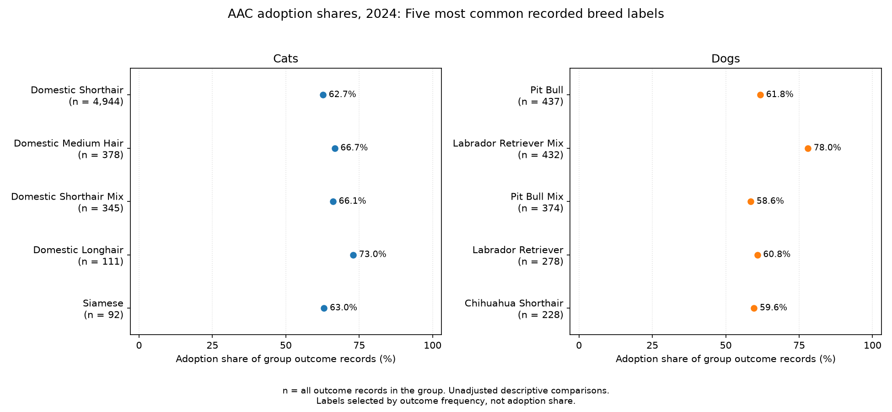
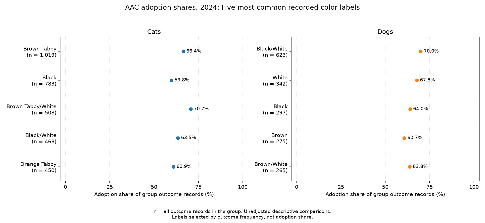
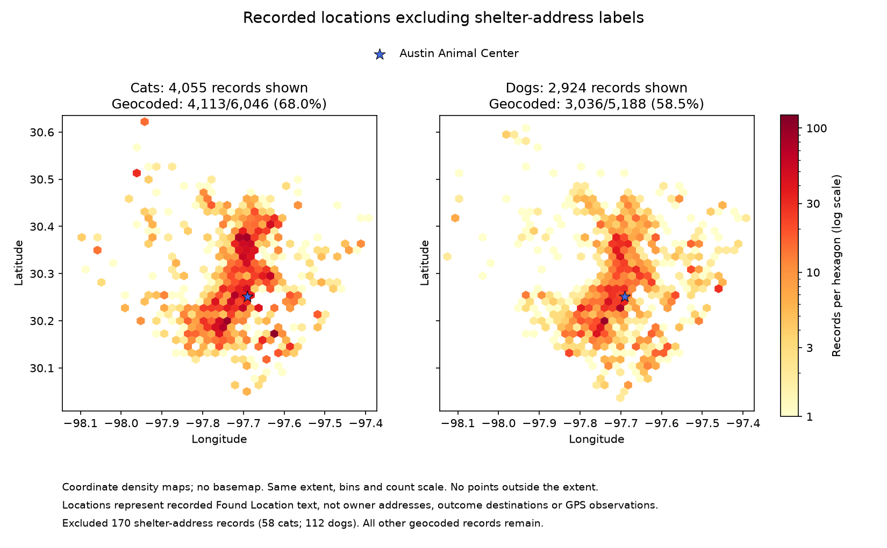

# Basic Analysis of Austin Animal Center Records in 2024

## Goal

We look at the cats and dogs recorded at Austin Animal Center in 2024:
what they were like, when and how they arrived, their recorded outcomes,
and where their intake locations were reported.

## Data Source

We use the City of Austin's [intake](https://data.austintexas.gov/d/wter-evkm)
and [outcome](https://data.austintexas.gov/d/9t4d-g238) datasets, restricted to
January–December 2024. The raw files are in [data/raw](../../data/raw/).

| Cleaned dataset | All records | Cats | Dogs |
| --- | ---: | ---: | ---: |
| [Intakes](../../data/processed/aac_intakes_clean.csv) | 11,815 | 6,046 | 5,188 |
| [Outcomes](../../data/processed/aac_outcomes_clean.csv) | 11,822 | 6,011 | 5,233 |
| [Geocoded intakes](../../data/processed/aac_intakes_clean_geocoded.csv) | 7,545 | 4,113 | 3,036 |

Each row is an **event**, so one animal may appear more than once. We analyze
intakes and outcomes separately rather than following the same animals from
arrival to departure. The figures focus on cats and dogs.

## Data Preparation and Methodology

The [cleaning scripts](../../code/data_cleaning/) standardize dates, keep
2024 records, and remove duplicate events. We use all cleaned records for
the summaries and the geocoded subset for maps.

- Ages are grouped as under 6 months, 6–under 12 months, 1–under 3 years,
  3–under 7 years, and 7 years or older. We keep `0 years` separate because
  its meaning is unclear. Original breed and color labels are retained.
- Female and male groups combine intact and spayed/neutered labels.
  Unknown and blank values remain in the data.
- Composition percentages use all intake or outcome records for each species.
  Monthly counts are totals, not daily averages.
- **Adoption share** is the number of records labeled `Adoption` divided by
  all outcome records in the same species and trait group, including blank
  outcome types. `Rto-Adopt` is kept separate. Traits in these comparisons
  are recorded at outcome.
- Maps count geocoded intake events. We also show a version excluding records
  with the shelter's address to see how much those records affect the pattern.

## Visualization and Findings

### 1. What Are the Cats and Dogs Like at Intake?


Cats have a younger age profile: **61.4%** of cat intake records report an age
under six months, compared with **31.5%** of dog records.



Female and male shares are similar for both species. Unknown sex is more
common in cat records (**6.5%**) than dog records (**0.9%**).



`Domestic Shorthair` makes up **82.6%** of cat records. Dog breed labels are
more varied: the five most common labels together account for only **32.8%**.

[Profile table](../basic_analysis/tables/01_intake_profile/intake_profile.csv)

### 2. When Are Intakes Most Common?


Cat intakes peak in **May, with 887 records**. Dog intakes peak in
**April and May, with 512 records each**.



Young cats account for much of the May peak: **653 of 887 records (73.6%)**
report an age under six months.

[Monthly intake and age tables](../basic_analysis/tables/02_intake_timing/)

### 3. How Do Animals Enter, and in What Condition?


`Stray` is the most common intake type for both cats (**81.8%**) and dogs
(**60.8%**). Owner surrender is more common among dogs (**22.8%**) than
cats (**14.3%**).



Most records are labeled `Normal`: **76.3%** for cats and **78.7%** for dogs.
Cats have a larger share labeled `Neonatal`, while dogs have a larger share
labeled `Injured`. These categories give a broad picture of condition at intake.

[Intake type and condition tables](../basic_analysis/tables/03_intake_context/)

### 4. What Outcomes Are Recorded?


| Outcome | Cats, n = 6,011 | Dogs, n = 5,233 |
| --- | ---: | ---: |
| Adoption | 3,819 (63.5%) | 3,460 (66.1%) |
| Transfer | 1,729 (28.8%) | 822 (15.7%) |
| Return to Owner | 153 (2.5%) | 676 (12.9%) |

Adoption shares are similar, but cats have a larger transfer share and dogs
have a larger return-to-owner share. The chart and
[full table](../basic_analysis/tables/04_outcome_profile/outcome_distribution.csv)
include the remaining categories and records with missing outcome types.

These shares describe the 2024 outcome records, not the eventual outcomes
of all animals admitted in 2024.

### 5. How Do Adoption Shares Differ Across Groups?

Each point below shows the group's adoption share and sample size, `n`.


Among the five defined age bands, the **6–under 12 months** group has the
highest adoption share: **77.0%** for cats and **83.9%** for dogs. The
`0 years` groups have just 12 cat and two dog records, so their percentages
are not useful for drawing broader conclusions.



Female and male shares are close for cats (**67.7%** and **68.2%**). For dogs,
they are **69.7%** and **64.0%**. Unknown-sex records are shown separately.



We show the five most common breed labels for each species. For dogs,
`Labrador Retriever Mix` has a **78.0%** adoption share, compared with
**58.6%** for `Pit Bull Mix`.



We also show the five most common color labels. For example, cat records
labeled `Brown Tabby/White` have a **70.7%** adoption share, compared with
**59.8%** for `Black`. These groups may differ in age and other characteristics;
the comparison alone does not show a preference for a particular color.

[All trait groups and sample sizes](../basic_analysis/tables/05_trait_comparisons/adoption_by_trait.csv)

### 6. What Do the Maps Show?


Each hexagon counts intake events with a geocoded `Found Location`.
Coverage is **68.0%** for cats and **58.5%** for dogs. The marker shows the
shelter at **7201 Levander Loop**.



The second map removes **58 cat and 112 dog records** with the shelter's
address. Such records may reflect where an animal was reported or delivered,
rather than where it was found.

Geocoding coverage also differs by intake type: across all species,
**75.2%** of stray records are mapped, compared with **13.1%** of owner
surrenders. The maps therefore show a selected part of the intake data.

[Coverage, location precision, and map checks](../basic_analysis/tables/06_intake_locations/)

## Limitations

- One year of monthly counts cannot establish a recurring seasonal pattern,
  and months have different numbers of days.
- Ages are approximate, breed and color labels may be imprecise, and some
  groups are small. Outcome traits may also differ from traits at intake.
- Adoption comparisons do not adjust for differences between groups and
  cannot establish cause and effect.
- Mapped locations are approximate and are not owner addresses or adoption
  destinations. Counts are not measures of neighborhood risk, and AAC
  records do not cover all animals in Austin.

## Extensions

We could compare several years, examine trait differences within similar
age groups, and check how spatial patterns change with geocoding coverage
or map settings. Questions about shelter stays or repeat intakes would
require a separate analysis linking intake and outcome events.

## Reproducing the Analysis

Run these commands from the repository root with Python 3:

```bash
python -m pip install -r requirements.txt
python code/basic_analysis/01_intake_profile.py
python code/basic_analysis/02_intake_timing.py
python code/basic_analysis/03_intake_context.py
python code/basic_analysis/04_outcome_profile.py
python code/basic_analysis/05_trait_comparisons.py
python code/basic_analysis/06_intake_locations.py
```

Each script can run on its own using the processed CSVs already in the
repository. No new downloads or geocoding requests are needed.

The scripts save **14 PNG figures** in
[figures](../basic_analysis/figures/) and **12 CSV tables** in
[tables](../basic_analysis/tables/), with one folder per theme. Rerunning a
script replaces its outputs without changing the input data.
