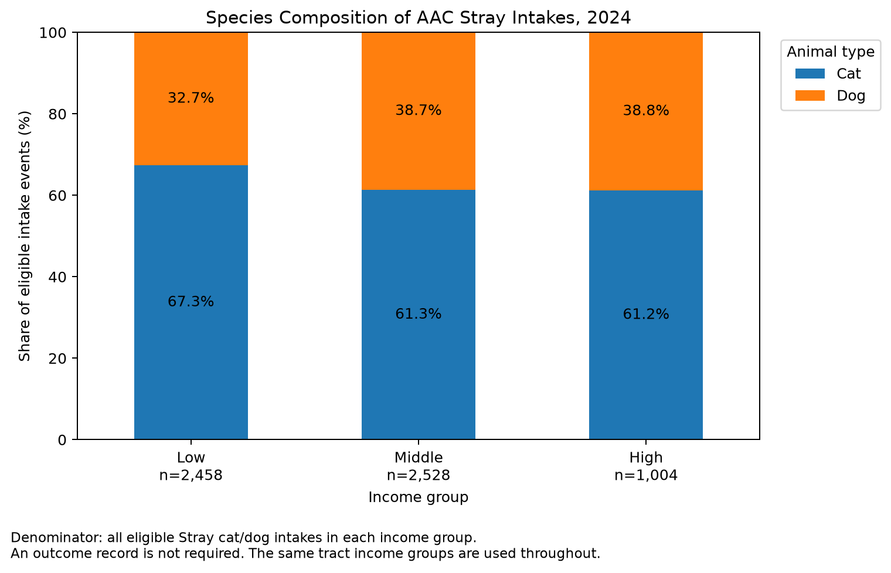
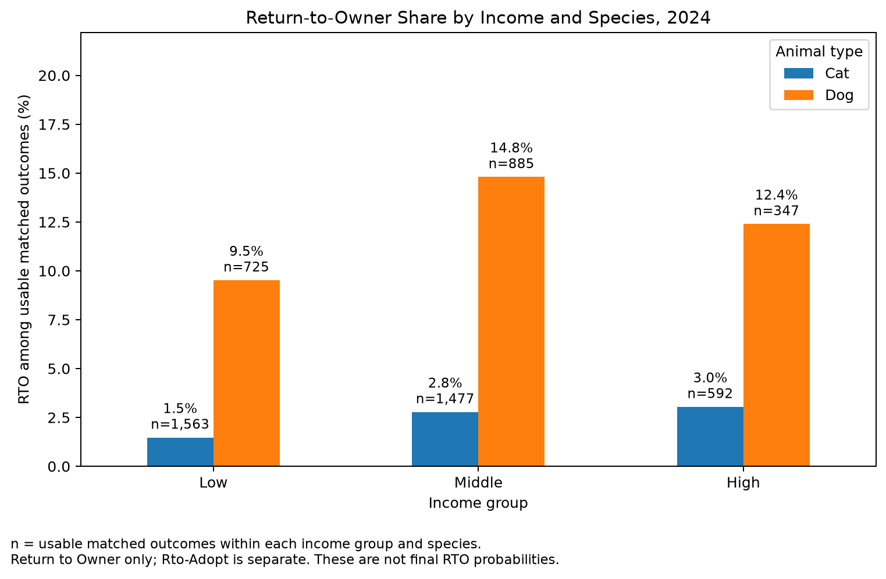

# Income and Found Location: AAC Stray Cats and Dogs in 2024

## Goal

This module examines how recorded stray-animal intakes and shelter outcomes vary across Census tract income groups. It addresses three questions:

1. How many stray cat and dog intake events come from lower-, middle-, and higher-income tracts?
2. Do the species and age composition of those intakes differ across income groups?
3. Do recorded shelter outcomes differ across income groups, particularly adoption and return to owner?

The analysis uses **5,990 intake events from 269 observed Census tracts**. It covers all areas represented in the eligible AAC records, rather than restricting the sample to Austin's council districts or to Travis County. These are descriptive comparisons, not estimates of income's causal effect.

## Data Sources

| Source | Collection and use in this module |
| --- | --- |
| [AAC Intakes](https://data.austintexas.gov/d/wter-evkm) and [AAC Outcomes](https://data.austintexas.gov/d/9t4d-g238), City of Austin Open Data | The team downloaded the historical CSVs and cleaned the 2024 records. The shared episode-building script pairs outcomes with preceding intakes. Income reuses these files rather than downloading AAC records again. |
| [City of Austin COA Locator](https://maps.austintexas.gov/arcgis/rest/services/Geocode/COA_Locator/GeocodeServer) | The team's upstream geocoding script requests coordinates for recorded found locations through the ArcGIS service. Income uses the saved `aac_intakes_clean_geocoded.csv`, including its existing coordinates; it does not use the Census Geocoder. |
| [2024 ACS 5-Year, Table B19013](https://data.census.gov/table/ACSDT5Y2024.B19013) | The Texas tract table was downloaded from the Census website and saved as `census_tract_income_2024.zip`. `clean_income.py` reads `ACSDT5Y2024.B19013-Data.csv` inside that ZIP. Income does not fetch these estimates through the API. |
| [2024 TIGER/Line Texas tract boundaries](https://www2.census.gov/geo/tiger/TIGER2024/TRACT/tl_2024_48_tract.zip) | The saved `tl_2024_48_tract.zip` supplies tract polygons and 11-digit `GEOID` values for matching animal coordinates to income. The boundary file does not itself contain income. |

The [Census variable documentation](https://api.census.gov/data/2024/acs/acs5/groups/B19013.html) defines `B19013_001E` as median household income in 2024 inflation-adjusted dollars and `B19013_001M` as its margin of error. The [2024 ACS five-year estimates](https://www.census.gov/data/developers/data-sets/acs-5year.html) cover **2020–2024**, not a survey conducted only in 2024.

### Inputs and relevant fields

The analysis runner reads three files already included in `data/processed/`:

| File | Unit and contents |
| --- | --- |
| `aac_intakes_with_income_2024.csv` | 11,815 intake events with tract and income fields added. |
| `census_tract_income_2024.csv` | 6,896 distinct Texas tracts; the income reference table. |
| `aac_intake_outcomes_with_income_2024.csv` | 11,815 intake episodes with the team's matched outcome information and income fields. |

| Field | Meaning and use |
| --- | --- |
| `Animal ID`, `Intake Date`, `Intake Time`, `Intake Type` | Together identify an intake event. `Animal ID` alone is not unique because animals can return. |
| `Found Location` | Recorded found-location text; used to identify explicit shelter-address records. It is not established as an owner's home address. |
| `latitude`, `longitude`, `location_precision` | Upstream geocoding fields used in data construction. They are not all carried into the final Income tables. |
| `tract_geoid` | Eleven-digit tract identifier, read as text. |
| `median_income`, `income_status` | Tract household income estimate and its status: `numeric`, `above_upper_limit`, or `missing_or_special`. |
| `Animal Type`, `Age upon Intake` | Species and recorded age at intake, used for composition comparisons. |
| `Outcome_DateTime`, `Outcome Type` | Matched outcome time and category, used to determine usable outcomes. |
| `income_group` | Derived Low, Middle, or High group; the same tract assignment is used for all three questions. |

The tract reference also retains `NAME`, `income_raw`, and `B19013_001M`. Raw special values and margins of error are preserved, but the analysis does not model income-estimation uncertainty. The dataset does not provide owner/adopter income, reliable owner residence, or a count of all pets or all stray animals in each area. **Population is not included in the current analysis.**

## Methodology

### 1. Constructing the Income dataset

`clean_income.py` skips the Census field-description row, removes repeated rows, extracts the tract identifier, and converts interpretable income values to numbers. Special or missing values are not replaced with zero. Values such as `250,000+` are flagged rather than treated as exactly \$250,000.

`merge_income.py` converts the team's coordinates into geographic points, transforms them from EPSG:4326 to the tract boundary's coordinate system, and performs a `within` spatial join. It then adds income by tract and joins those fields back to all intake events and the shared episode table. The full outputs retain records without a tract or numeric income. The joins validate tract uniqueness and the four-field intake-event key.

### 2. Selecting the analysis sample

The observation is **one intake event**, not one distinct animal. The analysis verifies the input year and retains `Intake Type == "Stray"` and `Animal Type` in `Cat` or `Dog`.

| Stage | Events retained |
| --- | ---: |
| All 2024 intake events | 11,815 |
| Stray cats and dogs | 8,103 |
| With a matched Census tract | 6,081 |
| With numeric tract income | 6,050 |
| After shelter-address exclusion | **5,990** |

The 31 tract-matched events without numeric income include 22 upper-limit records and 9 missing/special records. The address rule then removes 60 records containing `7201 Levander`, case-insensitively. It does not remove every record on Levander Loop or the whole surrounding tract.

The sample contains **3,818 cat and 2,172 dog events**. It includes 5,901 events in Travis County, 73 in Williamson, 10 in Hays, and 6 in Bastrop. This distribution does not establish complete AAC coverage of any county.

Overall, 73.92% of the original Stray cat/dog events enter the analysis. Retention is **77.16% for cats** and **68.84% for dogs**, so the matched sample has uneven coverage across species. See [sample flow](../income/tables/sample_flow.csv) and [species coverage](../income/tables/sample_coverage_by_species.csv).

### 3. Defining income groups

The code first creates one row per eligible observed tract, then applies `pandas.qcut` to its income. Each tract receives equal weight when calculating the cutpoints, regardless of its number of intake events. Equal income values are not split merely to force equal group sizes.

| Group | Observed tracts | Income interval, rounded to cents |
| --- | ---: | --- |
| Low | 90 | \$18,286.00 to \$82,838.67 |
| Middle | 89 | Above \$82,838.67 to \$106,573.67 |
| High | 90 | Above \$106,573.67 to \$249,063.00 |

These labels are relative to the **269 tracts represented in the selected sample**, not official poverty categories or terciles of all Texas tracts. Tracts without eligible observed intake records are not added as zero-count areas. Exact cutpoints and inclusion rules are saved in [income_group_cutpoints.csv](../income/tables/income_group_cutpoints.csv); individual assignments are in [tract_income_groups.csv](../income/tables/tract_income_groups.csv). All questions reuse this grouping rule and the same input sample.

### 4. Counts, composition, and outcome denominators

Intake counts include every eligible event, whether or not an outcome is available. Species percentages divide each species' intake count by all eligible cat/dog intakes in that income group.

Age composition is calculated separately within each species and income group. It follows the [Basic Analysis age categories](../../code/basic_analysis/01_intake_profile.py): `<6 months`, `6 to <12 months`, `1 to <3 years`, `3 to <7 years`, and `7+ years`. `Recorded as 0 years` and `Not recorded` remain separate categories and remain in the denominator. Zero years is not automatically classified as newborn.

For outcomes, the code joins the existing episode table to the fixed intake sample using all four event-key fields. A usable outcome must have a parseable time at or after the intake, before January 1, 2025, and a nonblank outcome category. Outcome percentages divide category counts by **usable matched outcomes**, while coverage divides usable outcomes by **all eligible intakes**.

`Rto-Adopt` remains separate from both `Adoption` and `Return to Owner`. Literal `Missing` and `Lost` labels are recorded categories, not blank cells. The main outcome figure groups the remaining explicit categories into `Other recorded`; the detailed CSV preserves them separately. Unavailable outcomes are not counted as failed adoptions or failed returns to owner.

## Findings

### 1. Intake counts by income group

| Income group | Observed tracts | Cat intakes | Dog intakes | Total intakes |
| --- | --- | --- | --- | --- |
| Low | 90 | 1,655 | 803 | 2,458 |
| Middle | 89 | 1,549 | 979 | 2,528 |
| High | 90 | 614 | 390 | 1,004 |


The low- and middle-income groups have similar total intake counts, while the high-income group has fewer observed intakes. Both cats and dogs show this lower high-income count. The groups contain similar numbers of observed tracts, but they need not have similar populations, areas, or pet populations. **These are counts, not population-adjusted rates or estimates of stray-animal prevalence.**

Source table: [income_intake_summary.csv](../income/tables/income_intake_summary.csv).

### 2. Species and age composition

| Income group | Cat share | Dog share | Intake events |
| --- | --- | --- | --- |
| Low | 67.33% | 32.67% | 2,458 |
| Middle | 61.27% | 38.73% | 2,528 |
| High | 61.16% | 38.84% | 1,004 |



Cats make up 67.33% of low-income-group intakes, approximately six percentage points more than in the other groups. This describes the species mix among eligible AAC intake events, not the local population of cats and dogs.

The age results do not show a large monotonic difference in the youngest group: cats under six months account for **64.29%, 65.27%, and 62.38%** of cat intakes in the Low, Middle, and High groups. The corresponding dog shares are **34.87%, 33.50%, and 33.85%**. These within-species percentages should not be confused with the overall cat shares above. No statistical-significance test is used for these comparisons.

Source tables: [species composition](../income/tables/income_species_composition.csv) and [age composition](../income/tables/income_age_composition.csv). The [cat age figure](../income/figures/a1_income_age_cat.png) and [dog age figure](../income/figures/a1_income_age_dog.png) provide supplementary detail.

### 3. Recorded shelter outcomes

| Income group | Intake events | Usable outcomes | Coverage |
| --- | --- | --- | --- |
| Low | 2,458 | 2,288 | 93.08% |
| Middle | 2,528 | 2,362 | 93.43% |
| High | 1,004 | 939 | 93.53% |

There are **5,589 usable outcomes among 5,990 eligible intakes (93.31%)**. The other 401 events consist of 399 without a recorded outcome time and 2 with a time but no outcome category. They are retained for the coverage calculation, but excluded from outcome-composition denominators.

| Income group | Adoption | Return to Owner | Transfer | Rto-Adopt | Other recorded |
| --- | --- | --- | --- | --- | --- |
| Low | 59.00% | 4.02% | 31.21% | 0.79% | 4.98% |
| Middle | 63.34% | 7.28% | 24.60% | 0.85% | 3.94% |
| High | 58.36% | 6.50% | 30.35% | 0.96% | 3.83% |


Adoption is the most frequent recorded outcome in each group. Its share is highest in the middle-income group (63.34%), compared with 59.00% in Low and 58.36% in High. Transfer has a lower share in the middle-income group. Neither adoption nor overall RTO follows a simple steadily increasing pattern with income.

These percentages describe the mix of usable recorded outcomes, not an intake animal's eventual adoption probability. Sources: [coverage](../income/tables/income_outcome_coverage.csv), [full outcome categories](../income/tables/income_outcome_composition.csv), and [plotted outcome categories](../income/tables/income_outcome_plot_summary.csv).

### 4. Return to owner, separately for cats and dogs

| Income group | Cat RTO / usable outcomes | Cat share | Dog RTO / usable outcomes | Dog share |
| --- | --- | --- | --- | --- |
| Low | 23 / 1,563 | 1.47% | 69 / 725 | 9.52% |
| Middle | 41 / 1,477 | 2.78% | 131 / 885 | 14.80% |
| High | 18 / 592 | 3.04% | 43 / 347 | 12.39% |



The RTO share is higher for dogs than cats in every income group. Among dogs, it is highest in the middle-income group: **9.52%, 14.80%, and 12.39%** across Low, Middle, and High. The cat shares are **1.47%, 2.78%, and 3.04%**. Separating species therefore matters when interpreting the aggregate outcome comparison. These figures do not isolate an income effect or estimate complete-follow-up RTO probabilities.

Sources: [RTO by species](../income/tables/income_rto_by_species.csv) and [all outcomes by species](../income/tables/income_outcomes_by_species.csv).

## Limitations

- **Selected records and selected tracts.** The study observes eligible AAC intakes, not all stray animals. Geographic/income matching excludes some events, with different retention rates for cats and dogs. Income groups are constructed only from tracts with eligible records, so areas without observed matched intakes are not represented.
- **Counts lack an exposure denominator.** Population, pet ownership, tract area, reporting, and shelter service coverage may differ. No population-adjusted intake rates have been calculated, and the four counties must not automatically be treated as a fully covered service area.
- **Location and income measurement.** A recorded found location is not established as the animal's long-term residence or its owner's home. Geocodes can be approximate. ACS income is a five-year area estimate with sampling error; upper-limit records are excluded, and the margin of error is not used to adjust group assignment.
- **Incomplete outcome observation.** Both the source outcome window and this analysis end in 2024. For December intakes, usable-outcome coverage is only **46.20%, 51.82%, and 54.05%** across the three groups, despite annual coverage near 93%. Similar annual coverage does not remove year-end follow-up limitations or other reasons for unmatched records. See [monthly coverage](../income/tables/income_outcome_coverage_by_month.csv).
- **Descriptive comparisons, not causal estimates.** The analysis does not control for seasonality, neighborhood characteristics, shelter operations, or all animal traits. An animal can enter more than once, and records from the same tract may be related. There are no regression estimates, confidence intervals, or significance tests in the Income module.

## Potential Extensions

An important extension is to add tract population and calculate matched AAC intake events per 1,000 residents. This first requires an explicit geographic/service universe, appropriate treatment of tracts with no observed matched events, and population counted once per tract. Summing all four counties' populations would not by itself provide a valid denominator for the current selected sample.

Additional outcome records, including 2025 outcomes for late-2024 intakes, would support a common follow-up window or time-to-outcome analysis. Further checks could examine geocoding precision, excluded upper-limit incomes, alternative income cutpoints, and within-age comparisons. The current code saves [outcomes by species and age](../income/tables/income_outcomes_by_species_age.csv), but this is stratified description rather than a formal adjusted model. These extensions have not been presented as completed findings.

## Reproducing the Analysis

### Run from the committed data

Run the following commands from the repository root. The root requirements include `geopandas==1.2.0` for spatial reconstruction; that release requires [Python 3.11 or later](https://pypi.org/project/geopandas/1.2.0/).

```bash
python3 -m venv .venv
source .venv/bin/activate
python -m pip install -r requirements.txt
python code/income/analyze_income.py
python code/income/test_income.py
```

The activation command is for Linux, WSL, or macOS. With the committed processed data, the analysis itself needs no API request or private credential after packages are installed. It uses a single analysis entry point and saves **15 CSV summary tables and 6 PNG figures** under `artifacts/income/`. Re-running replaces these generated outputs but does not modify the input CSVs or Census ZIPs. Summary counts should end at 5,990 events and 269 observed tracts for this data snapshot.

The tests check Stray/species selection, equal tract weighting and tied incomes, conflicting tract incomes, age boundaries, outcome-denominator rules, sample/composition totals, and actual outcome coverage. A successful run ends with `Ran 7 tests` and `OK`. These are internal consistency checks, not independent verification of every address or upstream intake–outcome match.

The runner also accepts `--stage sample`, `--stage intakes`, `--stage composition`, or `--stage outcomes` for checking one component. Each stage rebuilds its in-memory sample from the same inputs; no manually edited intermediate sample is needed.

### Rebuild the Income-specific input tables

The repository also includes the two raw Census ZIPs and the team's cleaned, geocoded, and episode-level AAC snapshots. To rebuild tract income and the two income-enriched event files from those fixed inputs:

```bash
python code/income/clean_income.py
python code/income/merge_income.py
python code/income/analyze_income.py
python code/income/test_income.py
```

`merge_income.py` requires `aac_intakes_clean.csv`, `aac_intakes_clean_geocoded.csv`, and `aac_in-out-episodes_2024.csv` in `data/processed/`. The two build scripts overwrite Income-generated processed files, but not the raw ZIPs or the three team input files.

**Upstream reconstruction note:** Regenerating coordinates from original found-location text is a separate team step. In this snapshot, `code/data_cleaning/geocode_aac_intakes.py` still uses `Path(__file__).resolve().parents[1]` after moving into `code/data_cleaning/`. This resolves to `code/`, not the repository root, and must be changed to `parents[2]` before the default geocoding command can run. The saved geocoded CSV allows both reproduction routes above to run without that live API step. Live geocoding was not used to reproduce these results.

### Files and supplementary checks

The program files are in [code/income](../../code/income/): `income_sample.py`, `income_intakes.py`, `income_composition.py`, and `income_outcomes.py`, coordinated by `analyze_income.py`. `test_income.py` contains the automated tests. Package requirements are in the [root requirements.txt](../../requirements.txt).

All four main figures and their source tables are linked with the findings above. Additional checks include [outcome coverage by species](../income/tables/income_outcome_coverage_by_species.csv), [monthly outcome coverage](../income/tables/income_outcome_coverage_by_month.csv), and [species-by-age outcome tables](../income/tables/income_outcomes_by_species_age.csv). New analysis outputs are aggregate tables and charts; no new precise animal-location file is exported by the analysis runner.
