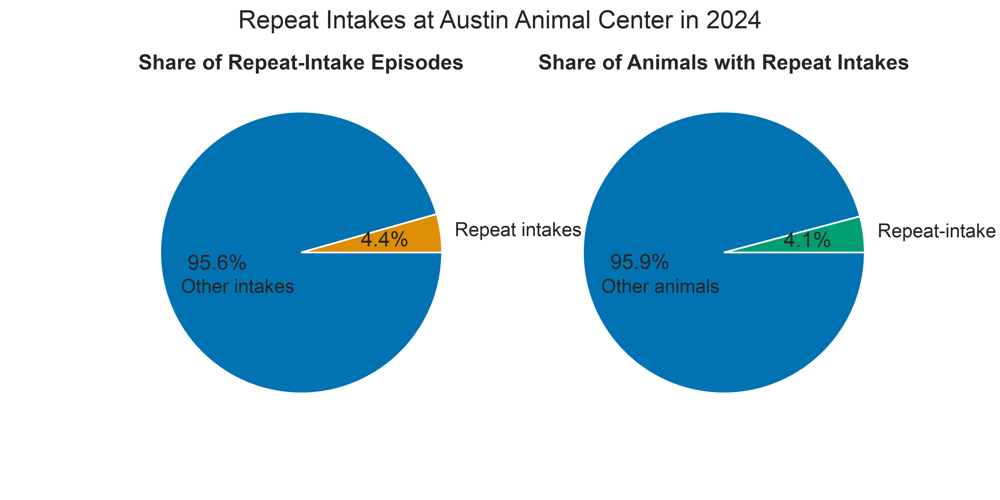
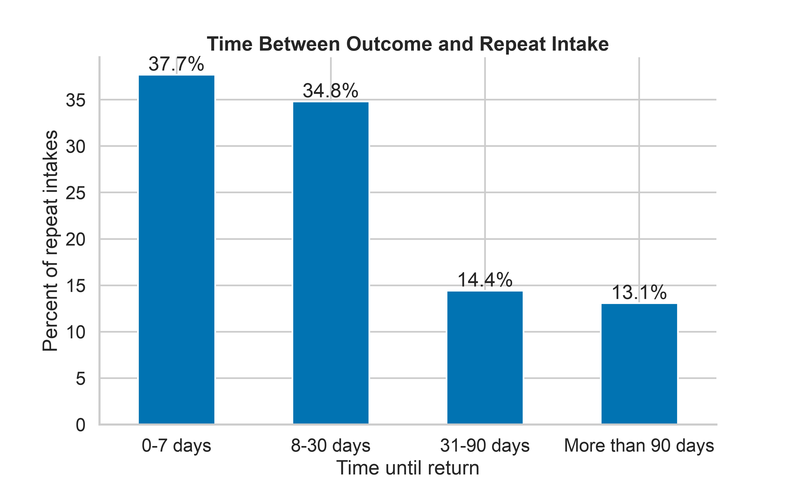
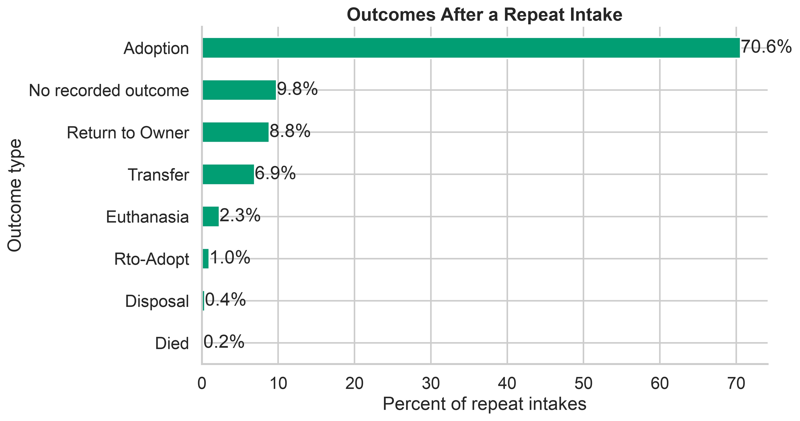
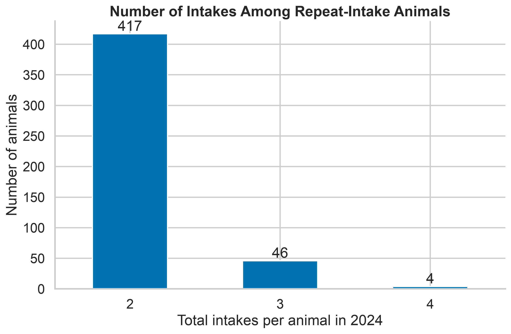

# Repeat Animal Intakes at Austin Animal Center in 2024
## Goal
This analysis measures the scale, timing, pathways, and subsequent
outcomes of repeat animal intakes at Austin Animal Center during 2024.
### Research Questions
Specifically, the analysis addresses the following questions:
1. How many repeat-intake episodes occurred?
2. How many unique animals were involved?
3. How quickly did animals return?
4. What were the most common pathways back to the shelter?
5. What outcomes followed repeat-intake episodes?
6. How many animals experienced two, three, or four intake episodes?
## Data Source
### Raw Data
The original City of Austin datasets contain records from multiple
years. This analysis restricts both datasets to events occurring from
January 1 through December 31, 2024. <br>The raw CSV files are placed in data/raw folder, and the websites for downloading the raw data are listed below:
* Austin Animal Center Intakes: https://data.austintexas.gov/Health-and-Community-Services/Austin-Animal-Center-Intakes-10-01-2013-to-05-05-2/wter-evkm/about_data
* Austin Animal Center Outcomes: https://data.austintexas.gov/Health-and-Community-Services/Austin-Animal-Center-Outcomes-10-01-2013-to-05-05-/9t4d-g238/about_data
## Data Preparation and Methodology
### 1. Cleaning the Intake and Outcome Data
The raw intake and outcome data are cleaned by `src/clean_aac_intake.py` and `src/clean_aac_outcomes.py`. 

The cleaning process includes the following steps:

1. **Standardize datetime values.**  
2. **Restrict the data to calendar year 2024.**  
3. **Remove duplicate event records.**  
   Intake duplicates are identified using `Animal ID`, `DateTime`, and
   `Intake Type`. <br> Outcome duplicates are identified using `Animal ID`,
   `Date of Birth`, `DateTime`, `Outcome Type`, and `Outcome Subtype`. <br>

4. **Sort records chronologically.**  

5. **Separate dates and times.**  
   This supports other parts of the project that analyze
   daily intake patterns, weather conditions, and time-related trends.

6. **Remove redundant fields.**  
   `Name` is removed because it is not needed for the analysis. <br>  `MonthYear` is removed because the same
   information can be derived from the standardized datetime field.

The cleaned datasets are saved as: 
``` 
data/processed/aac_intakes_clean.csv
data/processed/aac_outcomes_clean.csv
```
These two cleaned datasets serve as the shared inputs for the project's
subsequent analyses and for constructing the episode-level intake and
outcome dataset.
### 2. Building the Episode-Level Dataset

The cleaned intake and outcome datasets are then combined into an
episode-level dataset using `src/aac_in-out-episodes_2024.py`.

The episode-level dataset is constructed through the following steps:

1. **Order each animal's intake records.**  
   Intake records are sorted by `Animal ID` and `Intake_DateTime` so that each
   animal's observed intake history is in chronological order.
2. **Create unique intake episode identifiers.**  
   Each intake is assigned an `Intake Event Number`. An
   `Intake Event ID` is then created by combining the animal's
   `Animal ID` and `Intake Event Number`.
3. **Match outcomes to preceding intakes.**  
   `pandas.merge_asof()` is used to match each outcome to the most recent
   preceding intake for the same `Animal ID`. 
4. **Remove unmatched historical outcomes.**  
   Outcomes without a preceding intake in the 2024 intake data are
   removed because the corresponding intake may have occurred before the
   beginning of the study period.
5. **Resolve multiple matched outcomes.**  
   If multiple outcomes are matched to the same intake episode, only the
   earliest matched outcome is retained.
6. **Merge outcomes back onto all intake episodes.**  
   The matched outcome information is merged back onto the intake data. <br>
   Intake episodes without a matched outcome are retained, with their
   outcome fields left missing.
7. **Sort and save the completed episode table.**  
   The final dataset is sorted by `Animal ID` and
   `Intake Event Number` and saved as:

``` 
data/processed/aac_repeat-animal-intakes_2024.csv
```
### 3. Defining Repeat Intakes
We count an intake as a **repeat-intake episode** when an animal returns
to Austin Animal Center after previously leaving through one of the
following outcomes:
- `Adoption`
- `Return to Owner`
- `Rto-Adopt` 

We focus on these outcomes because they generally indicate that the
animal had left the shelter and returned to the community before coming
back. Returns following transfers or other outcome types are not
included, since those records may reflect movement between organizations
rather than a return from the community. <br>
### 4. Measures Used
The analysis uses the following measures:

- **Repeat-intake episodes:** Number of qualifying return events.
- **Repeat-intake animals:** Number of unique animals involved in at
  least one qualifying return.
- **Days to Return:** Number of days between the previous outcome and
  the next intake.
- **Return Pathway:** Combination of the previous outcome type and the
  next intake type.
- **Outcome After Return:** Outcome matched to the repeat-intake episode.
- **Number of Intakes:** Total number of observed 2024 intake episodes
  for each repeat-intake animal.
## Visualization and Findings
### 1. Scale of Repeat Intakes
Repeat-intake episodes accounted for about **4.4%** of all intake episodes in 2024. <br> At the animal level, about **4.1%** of unique animals experienced at least one qualifying repeat intake. 

### 2. Time Until Return
About **86.9%**  of qualifying repeat intakes occurred within 90 days of the previous outcome. <br> More than **72%** occurred within the first 30 days, suggesting that most observed returns happened relatively soon after the animal left the shelter.

### 3. Common Return Pathways

The most common return pathway was:

``` 
Adoption → Owner Surrender
```

This pathway accounted for approximately **71.0%** of qualifying
repeat-intake episodes. <br> It means that the animal was later surrendered to AAC by a legal owner. However, because the dataset does not include owner identity, we cannot determine whether that owner was the same person who originally adopted the animal.


### 4. Outcomes After Repeat Intake

Adoption was recorded after approximately **70.6%** of qualifying
repeat-intake episodes.

An animal may be adopted after a repeat intake and later return
again.

Episodes without a recorded outcome are kept in the calculation. These
records may represent animals that were still at the shelter at the end
of 2024 or whose outcomes occurred after the study period.


### 5. Number of Intake Episodes per Animal
Most animals with repeat intakes returned only once during 2024. Of the repeat-intake animals, **417** had two total intakes, compared with only **46** animals with three intakes and **4** animals with four intakes.

This means that about **89% of repeat-intake animals had exactly two observed intakes**, while repeated returns beyond a second intake were relatively uncommon.





## limitation

This analysis has several limitations:
1. **The analysis only covers 2024.**  
   Because we only look at intake and outcome records from 2024, some animals may have entered the shelter before 2024 or had an outcome after 2024. This means some repeat-intake histories, especially for animals entering near the end of the year, may be incomplete.

2. **Not every return pathway is included.**  
   The main repeat-intake definition only includes selected outcome types. For example, animals that left through `Transfer` and later came back are not included. Because of this, our results do not represent every possible way an animal could leave and later re-enter the shelter system.

3. **Some useful information is missing from the data.**  
   The dataset does not include owner identity or detailed reasons for why an animal returned. In addition, many `Found Location` values are not specific enough to reliably match to a Census tract. Because of these limitations, we cannot tell whether the same adopter returned the animal, explain the exact reason for the return, or fully study how repeat intake may be related to neighborhood characteristics such as income or crime.

4. **The AAC data do not represent all stray animals in Austin.**  
   The dataset only includes animals that entered the Austin Animal Center system. Stray animals that were picked up by other organizations, were reunited with owners without entering AAC, or remained outside the shelter system are not included. Therefore, our data provide only a partial view of the overall stray-animal population in the Austin area.

## Extensions
This analysis could be extended in several ways:

1. Use multiple years of intake and outcome data to build a more complete history for each animal.
2. Compare repeat-intake patterns across animal type, age, breed, sex,
   and intake condition.
3. Compare outcomes after first intakes with outcomes after repeat
   intakes.
4. Study whether animals returning more than once have different
   characteristics or outcomes.

## Reproducing the Analysis
### 1. Download the Raw data
You can use the raw intake and outcome files already available in the
`data/raw` folder. Alternatively, you can download the datasets from
the Austin Animal Center’s official data pages.

For the required file locations and download links, see the
[Data Source](#data-source) section above.
### 2. Clean the Intake and Outcome Data
Run the two cleaning scripts:
``` 
python src/clean_aac_intake.py
python src/clean_aac_outcomes.py
```
These scripts create:
``` 
data/processed/aac_intakes_clean.csv
data/processed/aac_outcomes_clean.csv
```
### 3. Build the Episode-Level Dataset
Match each intake with its corresponding outcome:
```
python src/aac_in-out-episodes_2024.py
```
This script creates:
```
data/processed/aac_in-out-episodes_2024.csv
```
### 4. Run the Repeat-Intake Analysis
Run the analysis and generate the figures:
```
python src/repeat-intakes-analysis.py
```
The figures are saved in:
```
artifacts/figures/
```
