# Weather and Animal Intake/Outcome Descriptive Analysis

## Research Overview

This analysis examines descriptive associations between weather conditions and animal intake and outcome events recorded by the Austin Animal Center in 2024.

Three research questions are considered:

1. Do wet days have different average daily animal intake counts compared with dry days?
2. Does the proportion of stray intake events differ between wet and dry days?
3. Does the proportion of adoption outcomes differ between hot and non-hot days?

The analyses focus on observed differences in daily event counts and event-type proportions. They do not attempt to establish causal relationships.

## Research Question 1: Rainfall and Daily Animal Intake Counts

### Data and Methodology

We use the cleaned Austin Animal Center intake dataset for 2024, containing 11,815 intake records, together with daily precipitation data from NOAA.

Individual intake events are aggregated by calendar date to construct daily intake counts. These counts are merged with the daily weather dataset by date. Wet days are defined as days with precipitation greater than 0 mm, while dry days are defined as days with zero precipitation.

The main analysis compares the mean, median, and standard deviation of daily intake counts between wet and dry days.

The cleaned intake dataset contains recorded events on 365 of the 366 calendar days in 2024. December 25 has no recorded intake events and is excluded from the main analysis because an absence of records does not necessarily indicate zero actual intakes. A sensitivity analysis treats this date as a zero-intake day.

### Findings

The main analysis includes 293 dry days and 72 wet days.

| Statistic | Dry Days | Wet Days |
|---|---:|---:|
| Number of days | 293 | 72 |
| Total intake events | 9,543 | 2,272 |
| Mean daily intakes | 32.57 | 31.56 |
| Median daily intakes | 32 | 33 |
| Standard deviation | 16.42 | 14.78 |

The average daily intake count is approximately 1.01 events lower on wet days than on dry days. However, the difference is small compared with the day-to-day variation observed within each group.

The median daily intake count is slightly higher on wet days, suggesting that the two groups have broadly similar typical daily intake volumes.

**Figure 1. Average Daily Animal Intakes on Dry and Wet Days (2024)**


The figure compares the average number of recorded daily animal intakes
between dry and wet days. The vertical axis begins at zero to avoid
visually exaggerating the small difference between the two groups. 

**Figure 2. Distribution of Daily Animal Intake Counts on Dry and Wet Days (2024)**


To complement the comparison of group means, the boxplot examines the distribution of daily intake counts across dry and wet days. The boxes represent the interquartile ranges (IQRs), the horizontal lines inside the boxes indicate the medians, and the diamond markers represent the means. Points beyond the whiskers indicate potential outliers under the 1.5 × IQR rule.

The two distributions overlap substantially. The median daily intake count is 32 on dry days and 33 on wet days, suggesting that typical daily intake volumes are similar across the two weather categories.

Dry days exhibit slightly greater overall variability, with a standard deviation of 16.42 compared with 14.78 on wet days. Several unusually high daily intake counts appear as outliers on dry days, whereas no similarly high outliers are identified on wet days.

Overall, the boxplot supports the interpretation of the original mean comparison: recorded daily intake volumes do not exhibit a pronounced descriptive difference between wet and dry days. However, these comparisons do not establish that precipitation has no effect on animal intake activity.

The boxplot uses the same 365 recorded intake days as the main analysis (293 dry days and 72 wet days), excluding December 25, 2024, because no intake records are available for that date. 

### Sensitivity Analysis

When December 25 is treated as a day with zero intake events, the number of wet days increases from 72 to 73, and the wet-day mean decreases from 31.56 to 31.12. The dry-day mean remains unchanged at 32.57.

The wet-minus-dry mean difference therefore changes from approximately −1.01 to −1.45 daily intake events.

The direction of the descriptive comparison remains unchanged under this alternative assumption.

### Limitations

This analysis is descriptive and cannot establish that rainfall causes changes in animal intake counts.

Differences in seasonality, weekdays, holidays, and shelter operations may influence recorded intake patterns. The absence of intake records on December 25 cannot be interpreted with certainty as zero actual events.

Furthermore, the binary wet-day indicator does not distinguish between light precipitation and heavy rainfall. Weather measurements also reflect conditions at the selected Austin weather station rather than every location where animals were found.

### Possible Extensions

Future research could examine precipitation intensity, account for seasonal and weekday differences, and investigate whether associations vary by animal type or intake category.

### Reproducibility

Run the analysis from the project root directory:

```bash
python3 code/weather_analysis/analyze_daily_intakes.py
```

This script reproduces the Q1 descriptive statistics, sensitivity analysis, and figure using the cleaned intake and processed weather data.

The generated outputs are:

- `artifacts/weather_analysis/figures/01_daily_intakes/wet_vs_dry_daily_intakes.png`
- `artifacts/weather_analysis/tables/q1_daily_intakes_summary.csv`

The required Python packages are listed in the project's root `requirements.txt` file. 


## Research Question 2: Rainfall and Stray Intake Proportions

### Data and Methodology 

This analysis examines whether the proportion of stray animal intake events differs between wet and dry days in Austin during 2024.

We use the cleaned Austin Animal Center intake dataset, containing 11,815 intake events, together with the daily weather dataset derived from NOAA observations.

Unlike Research Question 1, which aggregates intake events into daily counts, this analysis uses individual intake events as the unit of observation.

Each intake event is matched to its corresponding daily weather record using the intake date. The matching procedure uses a many-to-one relationship because multiple intake events can occur on the same calendar date, while each date has a single weather record.

Wet days are defined as days with precipitation greater than 0 mm, and dry days are defined as days with zero precipitation.

A binary indicator, `is_stray`, is created:

- `is_stray = 1` if the intake event is classified as `Stray`.
- `is_stray = 0` for all other intake types.

For each weather category, the stray intake proportion is calculated by dividing the number of stray intake events by the total number of intake events in that category.

All 11,815 intake events were successfully matched to weather records. No unmatched intake dates or duplicate weather dates were detected.

### Findings

The event-level analysis produces the following results:

| Statistic | Dry Days | Wet Days |
|---|---:|---:|
| Total intake events | 9,543 | 2,272 |
| Stray intake events | 6,575 | 1,636 |
| Non-stray intake events | 2,968 | 636 |
| Stray intake proportion | 68.90% | 72.01% |

The proportion of stray intake events was approximately **68.90% on dry days**, compared with **72.01% on wet days**.

The wet-minus-dry difference was approximately **3.11 percentage points**.

Thus, among recorded intake events, stray intakes accounted for a slightly larger share on wet days than on dry days.

**Figure 2. Stray Intake Proportions on Dry and Wet Days (2024)**


The figure compares the percentage of intake events classified as stray under the two weather conditions. Both proportions are calculated at the event level, and the vertical axis ranges from 0% to 100%.

### Interpretation Across Research Questions 1 and 2

The findings from Research Questions 1 and 2 provide complementary descriptions of animal intake patterns.

Research Question 1 shows that the average daily intake count was slightly lower on wet days than on dry days (31.56 versus 32.57).

Research Question 2 shows that the proportion of intake events classified as stray was slightly higher on wet days than on dry days (72.01% versus 68.90%).

Together, these results suggest that the overall number of recorded intake events and the composition of those events do not necessarily move in the same direction across weather conditions.

However, these comparisons describe observed associations and do not establish that rainfall caused changes in intake volume or composition.

### Limitations

This analysis is descriptive and does not establish a causal relationship between rainfall and stray intake proportions.

Differences in seasonality, weekdays, holidays, shelter operations, and other factors may influence the types of intake events recorded under different weather conditions.

The analysis uses a binary wet-day indicator and does not distinguish between light and heavy precipitation.

Daily precipitation measurements are based on weather observations from a selected Austin station and may not represent conditions at every animal intake location.

In addition, event-level observations may be clustered within calendar dates, and the analysis does not adjust for such dependence. No statistical significance test is performed.

Finally, the analysis describes the composition of recorded intake events rather than changes in the underlying stray animal population.

### Possible Extensions

Future research could investigate whether stray intake proportions vary with precipitation intensity, animal type, or season.

A more detailed analysis could also account for calendar-related factors and examine daily stray intake counts alongside event-level proportions.

These extensions may help distinguish variation in total intake activity from variation in the composition of intake events.

### Reproducibility

Run the Q2 analysis from the project root directory:

```bash
python3 code/weather_analysis/analyze_stray_intakes.py
```

The script validates the intake and weather date matching, calculates stray intake proportions, and generates the following outputs:

- `artifacts/weather_analysis/tables/q2_stray_intakes_summary.csv`
- `artifacts/weather_analysis/figures/02_stray_intakes/stray_proportion_wet_vs_dry.png`

The analysis uses cleaned intake data from `data/processed/aac_intakes_clean.csv` and daily weather data from `data/processed/austin_weather_2024.csv`.

Python package dependencies are listed in the project's root `requirements.txt` file. 


## Research Question 3: Extreme Heat and Adoption Outcome Proportions

### Data and Methodology

This analysis examines whether the proportion of adoption outcomes differs between hot and non-hot days in Austin during 2024.

We use the cleaned Austin Animal Center outcome dataset together with the daily weather dataset constructed from NOAA and Open-Meteo data. Daily maximum temperature is measured using NOAA observations.

The analysis uses individual outcome events as the unit of observation. Each event is matched to the corresponding daily weather record using its outcome date. Because multiple outcome events may occur on the same day, a many-to-one merge is used.

Hot days are defined as days when the daily maximum temperature is at least 35°C. Non-hot days are defined as days when the maximum temperature is below 35°C.

A binary indicator, `is_adoption`, is created:

- `is_adoption = 1` when `Outcome Type` is `Adoption`.
- `is_adoption = 0` for other known outcome types.

The `Rto-Adopt` category is treated separately from `Adoption` and is classified as non-adoption in the main analysis.

The cleaned dataset contains 11,822 outcome events. All events were successfully matched to weather records, and no invalid outcome dates or duplicate weather dates were identified.

Ten records with missing `Outcome Type` were excluded because their adoption status could not be determined. This leaves **11,812 valid outcome events**, including 7,431 adoption events.

For each weather category, the adoption outcome proportion is calculated by dividing the number of adoption events by the total number of outcome events with a known outcome type.

### Findings

The event-level descriptive analysis produces the following results:

| Statistic | Non-Hot Days | Hot Days |
|---|---:|---:|
| Total outcome events | 8,221 | 3,591 |
| Adoption outcomes | 5,093 | 2,338 |
| Non-adoption outcomes | 3,128 | 1,253 |
| Adoption proportion | 61.95% | 65.11% |

The adoption outcome proportion was approximately **61.95% on non-hot days** and **65.11% on hot days**.

The hot-minus-non-hot difference was approximately **3.16 percentage points**.

Thus, adoption accounted for a slightly larger share of recorded outcome events on hot days than on non-hot days.

**Figure 3. Adoption Outcome Proportions on Non-Hot and Hot Days (2024)**


The figure compares the percentage of recorded outcome events classified as adoption under the two weather conditions. The vertical axis ranges from 0% to 100%, and the comparison is conducted at the event level.

### Interpretation

The observed difference indicates that the composition of recorded outcome events varied across temperature categories in 2024.

However, the adoption outcome proportion measures the share of adoption events among recorded outcomes. It does not represent the probability that an individual animal entering the shelter will eventually be adopted.

The results are descriptive and do not establish that extreme heat increases adoption activity or causes changes in adoption outcomes.

### Limitations

This analysis is descriptive and cannot establish a causal relationship between temperature and adoption outcomes.

Seasonality may be particularly important because hot days are concentrated in warmer months, when shelter intake and adoption patterns may differ for reasons unrelated to temperature.

Weekdays, holidays, shelter operations, and animal characteristics may also influence observed outcome patterns.

The binary hot-day indicator does not distinguish between moderately hot days and periods of prolonged extreme heat. Weather measurements from a selected Austin station may not represent conditions at every location relevant to animal intake or adoption.

The analysis treats outcome events as observations rather than tracking individual animals from intake to final outcome. Consequently, the adoption proportion should not be interpreted as an animal-level adoption success rate.

In addition, outcome events occurring on the same date may be correlated, and the analysis does not adjust for this dependence or perform statistical significance testing.

Finally, the primary analysis excludes ten records with missing outcome types and treats `Rto-Adopt` as distinct from `Adoption`. Alternative classification choices could slightly change the reported proportions.

### Possible Extensions

Future research could examine temperature intensity rather than only a binary hot-day classification.

Additional analyses could account for seasonal patterns, weekdays, animal characteristics, and shelter operations.

Linking individual intake and outcome records could also support an investigation of adoption probabilities or time to adoption, rather than only the composition of recorded outcome events.

### Reproducibility

Run the Q3 analysis from the project root directory:

```bash
python3 code/weather_analysis/analyze_adoption_outcomes.py
```

The script loads the cleaned outcome and processed weather datasets, validates date matching, excludes records with missing outcome types, and calculates adoption proportions for hot and non-hot days.

The generated outputs are:

- `artifacts/weather_analysis/tables/q3_adoption_outcomes_summary.csv`
- `artifacts/weather_analysis/figures/03_adoption_outcomes/adoption_proportion_hot_vs_nonhot.png`

The input datasets are:

- `data/processed/aac_outcomes_clean.csv`
- `data/processed/austin_weather_2024.csv`

Required Python packages are listed in the project's root `requirements.txt` file. 


## Research Question 4: Animal Type Heterogeneity in Weather-Related Intake and Outcome Patterns

### Research Objectives

The preceding analyses compare shelter intake and outcome patterns across weather conditions using all recorded animal types. However, aggregate comparisons may conceal differences between animal groups.

To investigate this possibility, we focus on dogs and cats and examine three related questions:

- **Q4a:** Do average daily intake counts on wet and dry days differ between dogs and cats?
- **Q4b:** Do stray intake proportions on wet and dry days differ between dogs and cats?
- **Q4c:** Do adoption outcome proportions on hot and non-hot days differ between dogs and cats?

These analyses extend Q1–Q3 by examining whether the observed weather-related patterns vary across animal types.

### Data and Methodology

We use the same cleaned Austin Animal Center (AAC) intake and outcome datasets and the processed 2024 Austin weather dataset used in the preceding analyses.

The analysis focuses on two categories in the `Animal Type` variable: `Dog` and `Cat`.

The 2024 intake dataset contains 5,188 dog intake events and 6,046 cat intake events, for a combined total of 11,234 events. The outcome dataset contains 5,233 dog outcome events and 6,011 cat outcome events, totaling 11,244 events.

Dogs and cats represent approximately 95% of the intake and outcome events in the cleaned datasets. Other animal types, including birds, livestock, and records classified as other animals, are excluded from this heterogeneity analysis but remain included in the original Q1–Q3 analyses.

**Q4a — Daily Intake Counts by Animal Type**

Individual intake events are grouped by intake date and animal type to calculate the number of dog and cat intake events recorded each day.

These daily counts are then merged with weather observations. We distinguish wet days, defined as days with precipitation greater than 0 mm, from dry days, defined as days with no recorded precipitation.

To ensure consistency with Q1, December 25, 2024, is excluded because no intake records are available for that date. On other dates with recorded AAC intake activity, an animal type with no recorded intake events is assigned a daily count of zero.

Both dogs and cats are therefore analyzed using the same 365 dates: 293 dry days and 72 wet days.

For each animal type and weather group, we calculate the total intake events, mean daily intake count, median daily intake count, and standard deviation.

**Q4b — Stray Intake Proportions by Animal Type**

Individual dog and cat intake events are matched to daily precipitation observations using their intake dates.

An event is classified as a stray intake when `Intake Type` equals `Stray`.

Within each animal type and rainfall category, the stray intake proportion is calculated as:

Stray intake proportion = (Stray intake events / Total intake events in the group) × 100%.

All 11,234 dog and cat intake events are included in this calculation.

**Q4c — Adoption Outcome Proportions by Animal Type**

Individual dog and cat outcome events are matched to daily maximum temperature observations using their outcome dates.

A hot day is defined as a day with maximum temperature at or above 35°C. Other days are classified as non-hot days.

Consistent with Q3, an adoption is defined strictly as an event whose `Outcome Type` equals `Adoption`. The `Rto-Adopt` category is not counted as an adoption.

Of the 11,244 dog and cat outcome events, nine records have missing outcome classifications and are excluded. The remaining 11,235 events are used to calculate adoption outcome proportions within each animal type and temperature category:

Adoption outcome proportion = (Adoption outcome events / Outcome events with known types in the group) × 100%.

All comparisons are descriptive and do not estimate causal effects.

### Findings

#### Q4a: Rainfall and Daily Intake Counts by Animal Type

| Animal Type | Weather | Days | Total Intakes | Mean Daily Intakes | Median | Standard Deviation |
|---|---|---:|---:|---:|---:|---:|
| Dog | Dry | 293 | 4,194 | 14.31 | 13.0 | 7.64 |
| Dog | Wet | 72 | 994 | 13.81 | 14.0 | 6.86 |
| Cat | Dry | 293 | 4,863 | 16.60 | 15.0 | 11.41 |
| Cat | Wet | 72 | 1,183 | 16.43 | 14.5 | 10.08 |

The mean daily dog intake count was 14.31 on dry days and 13.81 on wet days, a wet-minus-dry difference of approximately **−0.50 events per day**.

For cats, the corresponding means were 16.60 and 16.43, a difference of approximately **−0.17 events per day**.

Thus, both animal types had slightly lower mean daily intake counts on wet days. The descriptive difference was somewhat larger for dogs than for cats.

Cat intake counts also exhibited greater day-to-day variability than dog intake counts across both weather categories.

**Figure 4a. Average Daily Dog and Cat Intakes on Dry and Wet Days (2024)**


These comparisons suggest that the relatively small overall wet-versus-dry difference identified in Q1 is also reflected in the two principal animal categories, although the magnitude varies somewhat by animal type.

#### Q4b: Rainfall and Stray Intake Proportions by Animal Type

| Animal Type | Weather | Total Intakes | Stray Intakes | Non-Stray Intakes | Stray Proportion |
|---|---|---:|---:|---:|---:|
| Dog | Dry | 4,194 | 2,517 | 1,677 | 60.01% |
| Dog | Wet | 994 | 638 | 356 | 64.19% |
| Cat | Dry | 4,863 | 3,974 | 889 | 81.72% |
| Cat | Wet | 1,183 | 974 | 209 | 82.33% |

Among dog intake events, the stray proportion increased from 60.01% on dry days to 64.19% on wet days, a difference of approximately **+4.18 percentage points**.

Among cat intake events, the stray proportion increased from 81.72% to 82.33%, a smaller difference of approximately **+0.61 percentage points**.

Cats consistently had a higher share of stray intake events than dogs under both weather conditions. However, the wet-versus-dry difference in the stray intake proportion was larger among dogs.

**Figure 4b. Stray Intake Proportions by Animal Type and Rainfall (2024)**


This result adds an important distinction to Q2. Although the overall stray intake proportion was higher on wet days, that difference was not uniform across animal types.

The difference between the wet-minus-dry changes for dogs and cats was approximately 3.57 percentage points. This is a descriptive comparison of group differences, not evidence of a statistically significant interaction or a causal effect.

#### Q4c: Extreme Heat and Adoption Outcome Proportions by Animal Type

| Animal Type | Weather | Valid Outcomes | Adoptions | Non-Adoptions | Adoption Proportion |
|---|---|---:|---:|---:|---:|
| Dog | Non-Hot | 3,863 | 2,543 | 1,320 | 65.83% |
| Dog | Hot | 1,363 | 917 | 446 | 67.28% |
| Cat | Non-Hot | 3,948 | 2,434 | 1,514 | 61.65% |
| Cat | Hot | 2,061 | 1,385 | 676 | 67.20% |

Among dog outcome events, the adoption proportion was 65.83% on non-hot days and 67.28% on hot days, a difference of approximately **+1.45 percentage points**.

Among cat outcome events, the adoption proportion was 61.65% on non-hot days and 67.20% on hot days, a larger difference of approximately **+5.55 percentage points**.

Thus, adoption represented a larger share of recorded outcome events on hot days for both animal types, but the descriptive difference was substantially larger among cats.

**Figure 4c. Adoption Outcome Proportions by Animal Type and Heat (2024)**


The difference between the hot-minus-non-hot changes for cats and dogs was approximately 4.10 percentage points.

This pattern helps qualify the aggregate finding from Q3. The higher overall adoption outcome proportion on hot days may reflect different patterns across animal categories rather than a uniform relationship for all animal types.

Importantly, the outcome proportion measures the composition of recorded shelter exits. It does not measure the probability that an individual dog or cat entering the shelter will ultimately be adopted.

### Overall Interpretation

The three analyses show that weather-related shelter event patterns vary both by animal type and by the activity being examined.

For daily intake volume, dogs and cats both exhibited slightly lower mean counts on wet days, although the differences were modest.

For stray intake composition, dogs showed a larger wet-versus-dry increase in the stray intake proportion than cats.

For adoption outcome composition, cats showed a larger hot-versus-non-hot increase in the adoption proportion than dogs.

These findings demonstrate that aggregate descriptive comparisons can obscure differences across animal groups.

However, the direction and magnitude of the differences depend on the specific outcome. The results do not establish that one animal type is universally more responsive to weather conditions.

### Limitations

Several limitations apply to this heterogeneity analysis.

First, comparisons are based on recorded shelter events rather than unique animals. An animal may contribute more than one event, and the resulting observations may not be statistically independent.

Second, animal types differ in their underlying intake and outcome compositions. These differences may reflect factors other than weather, including animal characteristics, shelter practices, adoption availability, and seasonal patterns.

Third, the analyses do not control for potential confounding variables such as weekdays, holidays, seasonal changes, shelter staffing, or changes in shelter capacity.

Fourth, although dogs and cats represent most recorded events, the results do not necessarily apply to other animal categories.

Fifth, Q4a measures average daily intake counts, whereas Q4b and Q4c measure event-level proportions. These quantities have different denominators and should not be interpreted interchangeably.

Sixth, the hot-day and wet-day indicators simplify continuous weather conditions into binary categories. Differences in rainfall intensity, temperature, and duration of weather events are not directly examined.

Finally, the observed group differences have not been subjected to formal statistical significance testing or causal identification. Differences in descriptive percentages should not be treated as evidence of statistically significant weather effects.

### Possible Extensions

Future analysis could investigate whether the observed differences remain after accounting for seasonality, weekdays, holidays, and shelter operational factors.

Additional animal-level information, including age, health condition, and prior shelter histories, could help explain variation in intake and outcome patterns.

Longer time series covering multiple years would provide a larger sample for evaluating whether these patterns are persistent.

More detailed weather measures could also support analyses of rainfall intensity, heat duration, and lagged weather conditions.

Finally, linked intake and outcome histories would allow future research to examine individual animal-level adoption probabilities and time to adoption, rather than relying solely on the composition of outcome events.

### Reproducibility

All Q4 analyses are implemented in:

`code/weather_analysis/analyze_animal_type_heterogeneity.py`

From the project root directory, run:

```bash
python3 code/weather_analysis/analyze_animal_type_heterogeneity.py
```

The script reads the following processed datasets:

- `data/processed/aac_intakes_clean.csv`
- `data/processed/aac_outcomes_clean.csv`
- `data/processed/austin_weather_2024.csv`

It produces three summary tables:

- `artifacts/weather_analysis/tables/q4a_daily_intakes_by_animal_type.csv`
- `artifacts/weather_analysis/tables/q4b_stray_proportions_by_animal_type.csv`
- `artifacts/weather_analysis/tables/q4c_adoption_proportions_by_animal_type.csv`

It also produces three figures:

- `artifacts/weather_analysis/figures/04_animal_type/q4a_daily_intakes_by_animal_type.png`
- `artifacts/weather_analysis/figures/04_animal_type/q4b_stray_proportions_by_animal_type.png`
- `artifacts/weather_analysis/figures/04_animal_type/q4c_adoption_proportions_by_animal_type.png`

The script uses project-relative paths, checks weather-date matching, verifies key event totals, and generates all statistics and figures programmatically.

Required Python packages are listed in the project's root `requirements.txt` file.


## Research Question 5: Rainfall and Animal Intake Type Composition

### Research Objective

Research Question 2 (Q2) found that stray intake events accounted for a slightly higher proportion of all animal intake events on wet days than on dry days. However, the binary comparison between stray and non-stray intakes does not reveal how the remaining intake categories contribute to the overall composition.

To extend Q2, this analysis examines the complete distribution of animal intake types across rainfall conditions.

The research question is:

**Does the composition of animal intake types differ between wet and dry days?**

Specifically, we compare the proportions of six intake categories to identify which types account for larger or smaller shares of recorded intake events under different rainfall conditions.

### Data and Methodology

This analysis uses the same cleaned 2024 Austin Animal Center (AAC) intake dataset and processed Austin daily weather dataset used in Q1, Q2, and Q4.

The input datasets are:

- `data/processed/aac_intakes_clean.csv`
- `data/processed/austin_weather_2024.csv`

Each intake event is matched to the weather observation for its intake date using a many-to-one merge.

Rainfall conditions are classified as follows:

- **Dry day:** Daily precipitation equals 0 mm (`wet_day = 0`).
- **Wet day:** Daily precipitation is greater than 0 mm (`wet_day = 1`).

The analysis includes all **11,815 recorded intake events** from 2024:

- **9,543 events** occurred on dry days.
- **2,272 events** occurred on wet days.

All events were successfully matched to weather observations. No intake records were excluded due to missing intake types or unmatched weather dates.

The dataset contains six distinct intake classifications:

1. Stray
2. Owner Surrender
3. Public Assist
4. Abandoned
5. Wildlife
6. Euthanasia Request

All six categories are retained, including rare categories, to preserve the complete observed intake distribution.

For each weather category, we calculate:

1. The number of recorded events belonging to each intake type.
2. The proportion of that intake type among all intake events recorded under the same weather condition.
3. The wet-minus-dry difference in percentage points.

The intake type proportion is defined as:

**Intake Type Proportion (%) = (Events in a Specific Intake Type / Total Intake Events in the Weather Group) × 100**

The difference in proportions is calculated as:

**Wet − Dry Difference (pp) = Wet-Day Proportion (%) − Dry-Day Proportion (%)**

The proportions within each weather group sum to 100%.

This is an event-level descriptive analysis. The objective is to examine differences in recorded intake composition rather than estimate causal effects.

### Findings

#### Intake Type Composition by Weather Condition

The following table presents the number and proportion of intake events in each category under dry and wet conditions.

| Intake Type | Dry Events | Dry Share | Wet Events | Wet Share | Wet − Dry (pp) |
|---|---:|---:|---:|---:|---:|
| Stray | 6,575 | 68.90% | 1,636 | 72.01% | +3.11 |
| Owner Surrender | 1,728 | 18.11% | 400 | 17.61% | -0.50 |
| Public Assist | 590 | 6.18% | 120 | 5.28% | -0.90 |
| Abandoned | 342 | 3.58% | 62 | 2.73% | -0.85 |
| Wildlife | 306 | 3.21% | 54 | 2.38% | -0.83 |
| Euthanasia Request | 2 | 0.02% | 0 | 0.00% | -0.02 |
| **Total** | **9,543** | **100.00%** | **2,272** | **100.00%** | **0.00** |

*Note: Individual percentages are rounded to two decimal places, so their displayed sums may differ slightly from 100%.*

The largest observed difference is associated with the **Stray** category.

Stray intakes accounted for approximately **68.90% of all intake events on dry days**, compared with **72.01% on wet days**, representing a wet-minus-dry difference of approximately **+3.11 percentage points**.

This result is consistent with the original Q2 analysis and confirms that the higher stray intake share on wet days remains evident when all intake categories are examined separately.

In contrast, each of the other five intake categories represented a slightly smaller proportion of recorded intake events on wet days.

Among the non-stray categories, the largest percentage-point differences were:

- **Public Assist:** -0.90 percentage points.
- **Abandoned:** -0.85 percentage points.
- **Wildlife:** -0.83 percentage points.

Owner Surrender showed a smaller difference of approximately -0.50 percentage points.

Euthanasia Request accounted for only two events in the full dataset, both recorded on dry days. Because this category is extremely rare, its percentage difference should not be interpreted as evidence of a meaningful weather-related pattern.

#### Figure 5a. Animal Intake Type Composition on Dry and Wet Days (2024)


Figure 5a presents a 100% stacked bar chart comparing the relative shares of all six intake types on dry and wet days.

Stray intake events account for the largest share in both weather categories. Their share is slightly larger on wet days, while Owner Surrender, Public Assist, Abandoned, and Wildlife account for correspondingly smaller portions of the total.

Although the overall composition is broadly similar across rainfall conditions, the chart shows a modest shift toward a greater relative share of stray intake events on wet days.

#### Figure 5b. Wet-Minus-Dry Differences in Intake Type Shares (2024)


Figure 5b displays the wet-minus-dry percentage-point difference for each intake classification.

Positive values indicate that an intake type accounts for a larger share of recorded events on wet days, while negative values indicate a smaller share.

The figure highlights the approximately **+3.11 percentage-point difference for Stray**, compared with smaller negative differences for the other five categories.

Because the intake categories collectively account for all recorded intake events, their percentage-point differences necessarily sum to zero, apart from rounding.

Consequently, a higher share for one category must be accompanied by lower combined shares for other categories.

### Overall Interpretation

Q5 provides a more detailed explanation of the descriptive pattern identified in Q2.

The earlier analysis showed that the proportion of stray intake events was higher on wet days than on dry days. By examining all six intake categories, Q5 shows that the higher stray share is accompanied by slightly smaller shares of Owner Surrender, Public Assist, Abandoned, Wildlife, and Euthanasia Request.

The most notable difference is concentrated in the Stray category, while the individual differences across the remaining categories are each less than one percentage point in magnitude.

These findings suggest that the composition of recorded AAC intake events varies modestly between wet and dry days.

However, changes in intake proportions do not necessarily imply corresponding changes in absolute daily event counts. Because the analysis compares event shares within each weather category, a smaller share of an intake type does not by itself establish that rainfall reduces the number of events belonging to that category.

Overall, Q5 complements Q1 and Q2 by distinguishing three related but different measures:

- **Q1:** Total daily intake volume.
- **Q2:** The proportion of stray intake events.
- **Q5:** The complete composition of intake types.

Together, these analyses provide a more comprehensive descriptive view of shelter intake patterns under different rainfall conditions.

### Limitations

Several limitations should be considered when interpreting these results.

**First, the analysis is descriptive rather than causal.** Differences in intake type composition cannot establish that rainfall causes changes in animal intake classifications.

**Second, the data describe recorded intake events rather than unique animals.** An individual animal may contribute multiple records, meaning that event counts should not be interpreted as counts of distinct animals.

**Third, the analysis does not adjust for seasonality or other potential confounding factors.** Intake composition may vary with weekdays, holidays, shelter operating procedures, animal characteristics, and other environmental or institutional conditions.

**Fourth, the wet-day indicator does not distinguish rainfall intensity or duration.** Light precipitation and heavy rainfall are placed in the same category, even though their associations with animal shelter activity could differ.

**Fifth, sample sizes differ between the two weather groups.** The dataset contains substantially more intake events on dry days than on wet days. This imbalance should be considered when comparing categories with small event counts.

**Sixth, rare intake classifications provide limited information.** In particular, only two Euthanasia Request intake events appear in the dataset. No meaningful conclusions about its relationship with rainfall can be drawn from such a small number of observations.

Finally, the analysis does not include formal statistical significance testing. The reported differences are observed descriptive differences and should not be interpreted as statistically significant effects.

### Possible Extensions

Future research could explore whether rainfall-associated differences in intake composition vary across animal types, especially dogs and cats.

Further analysis could also examine the relationship between weather conditions and specific intake classifications within different seasons or months.

Using multiple years of intake and weather data would increase the number of observed wet days and provide additional information about whether the patterns are persistent.

Another extension would be to investigate how different intake classifications are associated with subsequent shelter outcomes, including adoption, transfer, and return to owner.

Such analyses would provide a more detailed understanding of the relationship between weather conditions, shelter intake pathways, and subsequent animal outcomes.

### Reproducibility

Q5 is implemented in the following Python script:

`code/weather_analysis/analyze_intake_type_composition.py`

The script uses the cleaned intake dataset and the processed daily weather dataset.

From the project root directory, run:

```bash
python3 code/weather_analysis/analyze_intake_type_composition.py
```

The script performs the following operations:

1. Loads the cleaned intake and daily weather datasets.
2. Validates the number of observations and intake classifications.
3. Matches each intake event to the corresponding daily weather observation.
4. Calculates event counts and proportions for all six intake types.
5. Computes wet-minus-dry percentage-point differences.
6. Validates the event totals and consistency with Q2.
7. Saves summary statistics and generates the two visualizations.

The generated summary tables are:

- `artifacts/weather_analysis/tables/q5_intake_type_composition.csv`
- `artifacts/weather_analysis/tables/q5_intake_type_differences.csv`

The generated figures are:

- `artifacts/weather_analysis/figures/05_intake_type/q5_intake_type_composition.png`
- `artifacts/weather_analysis/figures/05_intake_type/q5_intake_type_differences.png`

The script uses project-relative file paths and produces the results programmatically without requiring manual modifications to the datasets.

Required Python packages are listed in the project's root `requirements.txt` file.


### Additional Temperature Analyses: Extreme Heat and Cold Weather

In addition to rainfall, we extend Research Question 5 to examine whether the composition of recorded animal intake types varies across temperature conditions.

The extensions address two additional questions:

- **Q5b:** Does the composition of animal intake types differ between hot and non-hot days?
- **Q5c:** Does the composition of animal intake types differ between cold and non-cold days?

We also conduct a supplementary sensitivity analysis using a stricter freezing-day definition.

These analyses use the same six intake categories and the same 11,815 intake events as the rainfall analysis in Q5a. Each temperature comparison is conducted separately, and all findings are descriptive rather than causal.

### Q5b: Extreme Heat and Intake Type Composition

#### Research Objective

The objective of Q5b is to investigate whether the distribution of animal intake classifications differs between days with extreme heat and days without extreme heat.

Unlike Q5a, which focuses on precipitation, this analysis considers daily maximum temperature.

#### Data and Methodology

We use the cleaned 2024 Austin Animal Center intake dataset and processed daily weather data.

Each intake event is matched to the temperature recorded on its intake date.

Consistent with Q3 and Q4c, weather conditions are classified as:

- **Hot day:** Daily maximum temperature is at least 35°C (`hot_day = 1`).
- **Non-hot day:** Daily maximum temperature is below 35°C (`hot_day = 0`).

The dataset contains:

- **101 hot days**, with 3,230 recorded intake events.
- **265 non-hot days**, including 264 days with recorded intake events and 8,585 intake events.

December 25, 2024, has no recorded intake events and therefore does not contribute to the event-level proportions.

All 11,815 intake events are included.

For each temperature group, we calculate the number and percentage of intake events belonging to each of the six intake categories.

The hot-minus-non-hot difference is measured in percentage points:

**Difference (pp) = Hot-Day Share (%) − Non-Hot-Day Share (%)**

#### Findings

| Intake Type | Non-Hot Events | Non-Hot Share | Hot Events | Hot Share | Difference (pp) |
|---|---:|---:|---:|---:|---:|
| Stray | 5,966 | 69.49% | 2,245 | 69.50% | +0.01 |
| Owner Surrender | 1,601 | 18.65% | 527 | 16.32% | -2.33 |
| Public Assist | 494 | 5.75% | 216 | 6.69% | +0.93 |
| Abandoned | 283 | 3.30% | 121 | 3.75% | +0.45 |
| Wildlife | 239 | 2.78% | 121 | 3.75% | +0.96 |
| Euthanasia Request | 2 | 0.02% | 0 | 0.00% | -0.02 |
| **Total** | **8,585** | **100.00%** | **3,230** | **100.00%** | **0.00** |

*Note: Percentages and percentage-point differences are rounded to two decimal places.*

The proportion of Stray intake events was almost identical between hot and non-hot days: approximately 69.49% and 69.50%, respectively.

The hot-minus-non-hot difference was only +0.01 percentage points, indicating virtually no observed difference in the relative share of stray intakes across the two temperature categories.

In contrast, Owner Surrender accounted for a smaller share of intake events on hot days, decreasing from approximately 18.65% on non-hot days to 16.32% on hot days, a difference of -2.33 percentage points.

Public Assist and Wildlife represented slightly larger shares on hot days, increasing by approximately 0.93 and 0.96 percentage points, respectively.

Abandoned intake events also accounted for a somewhat larger share on hot days, with a difference of +0.45 percentage points.

Euthanasia Request is too rare to support meaningful interpretation.

#### Figure 5c. Intake Type Composition on Hot and Non-Hot Days (2024)


Figure 5c presents the complete intake type distribution under hot and non-hot conditions.

The Stray category accounts for nearly the same proportion of intake events in both groups, while relatively modest differences appear in the other categories.

#### Figure 5d. Hot-Minus-Non-Hot Differences in Intake Type Shares (2024)


Figure 5d shows the percentage-point differences between hot and non-hot days.

The largest difference is the lower Owner Surrender share on hot days, while the differences for Public Assist and Wildlife are positive but smaller.

#### Interpretation

Q5b suggests that extreme heat is associated with relatively modest differences in the composition of recorded animal intake events.

The near-identical Stray shares are particularly noteworthy when compared with Q5a, where wet days exhibited a higher stray intake proportion than dry days.

However, the absence of a substantial difference in the Stray share does not establish that extreme heat has no effect on the absolute number of stray intake events.

Similarly, the lower Owner Surrender share on hot days does not by itself imply that extreme heat reduces owner surrender activity.

The findings describe the relative composition of recorded events and may reflect seasonal, operational, or animal-related differences that are not controlled for in this analysis.

### Q5c: Cold Weather and Intake Type Composition

#### Research Objective

Q5c examines whether intake type composition differs between cold and non-cold days.

Because freezing conditions are relatively uncommon in Austin, we use a broader cold-day definition for the main analysis and examine freezing conditions separately as a sensitivity check.

#### Data and Methodology

Each intake event is matched to the daily minimum temperature on its intake date.

For the main analysis, the weather categories are:

- **Cold day:** Daily minimum temperature is at or below 5°C.
- **Non-cold day:** Daily minimum temperature is above 5°C.

This threshold identifies relatively cold days while retaining more observations than the stricter freezing-day definition.

The sample contains:

- **29 cold days**, with 708 recorded intake events.
- **337 non-cold days**, including 336 days with recorded intake events and 11,107 intake events.

The comparison includes all 11,815 intake events.

As in Q5a and Q5b, we calculate event counts, within-group percentages, and percentage-point differences for all six intake classifications.

The cold-minus-non-cold difference is:

**Difference (pp) = Cold-Day Share (%) − Non-Cold-Day Share (%)**

The 5°C threshold is an exploratory classification rather than an externally validated behavioral cutoff. It was selected after reviewing temperature coverage and sample sizes, but before examining the intake type composition results.

#### Findings

| Intake Type | Non-Cold Events | Non-Cold Share | Cold Events | Cold Share | Difference (pp) |
|---|---:|---:|---:|---:|---:|
| Stray | 7,793 | 70.16% | 418 | 59.04% | -11.12 |
| Owner Surrender | 1,957 | 17.62% | 171 | 24.15% | +6.53 |
| Public Assist | 646 | 5.82% | 64 | 9.04% | +3.22 |
| Abandoned | 366 | 3.30% | 38 | 5.37% | +2.07 |
| Wildlife | 343 | 3.09% | 17 | 2.40% | -0.69 |
| Euthanasia Request | 2 | 0.02% | 0 | 0.00% | -0.02 |
| **Total** | **11,107** | **100.00%** | **708** | **100.00%** | **0.00** |

*Note: Percentages and percentage-point differences are rounded to two decimal places.*

The most notable difference is observed in the Stray category.

Stray intake events accounted for approximately 70.16% of intake events on non-cold days, compared with 59.04% on cold days.

The cold-minus-non-cold difference was approximately **-11.12 percentage points**.

In contrast, Owner Surrender accounted for 24.15% of intake events on cold days, compared with 17.62% on non-cold days, an increase of approximately **6.53 percentage points**.

Public Assist also represented a larger share on cold days, increasing from 5.82% to 9.04%, a difference of approximately **3.22 percentage points**.

Abandoned intake events increased in relative share by approximately **2.07 percentage points**.

Wildlife represented a slightly smaller share on cold days, while Euthanasia Request remained extremely rare.

These descriptive differences are larger than many of the differences observed in the rainfall and extreme heat comparisons.

However, the cold-day sample contains only 29 days and 708 intake events, so the results require cautious interpretation.

#### Figure 5e. Intake Type Composition on Cold and Non-Cold Days (2024)


Figure 5e illustrates the complete intake type composition under the main 5°C cold-day definition.

The cold-day distribution has a smaller Stray share and relatively larger Owner Surrender, Public Assist, and Abandoned shares.

#### Figure 5f. Cold-Minus-Non-Cold Differences in Intake Type Shares (2024)


Figure 5f shows the percentage-point differences across the six intake categories.

The largest negative difference is observed for Stray, while the largest positive difference is observed for Owner Surrender.

#### Interpretation

The cold-weather comparison reveals a more pronounced descriptive shift in intake composition than the extreme heat comparison.

On cold days, Stray accounts for a substantially smaller proportion of recorded intake events, while Owner Surrender, Public Assist, and Abandoned account for larger proportions.

One possible avenue for future research is whether cold weather is associated with changes in the types of animals brought to shelters or the circumstances under which animals enter shelters.

However, the present evidence does not identify the mechanisms behind the observed differences.

In particular, the larger shares of Owner Surrender and Public Assist should not be interpreted as evidence that cold weather causes these events to increase.

The comparisons may reflect seasonal differences, shelter operations, animal characteristics, or other factors unrelated to the direct effects of temperature.

### Q5c Sensitivity Analysis: Freezing Days

#### Objective and Methodology

To evaluate how sensitive the main cold-weather findings are to the temperature threshold, we repeat the composition analysis using the existing `freezing_day` indicator.

The categories are:

- **Freezing day:** Daily minimum temperature is at or below 0°C.
- **Non-freezing day:** Daily minimum temperature is above 0°C.

The 2024 dataset contains:

- **7 freezing days**, with 180 recorded intake events.
- **359 non-freezing days**, including 358 days with recorded intake events and 11,635 intake events.

Because there are only seven freezing days, this analysis should be treated as exploratory.

#### Findings

| Intake Type | Non-Freezing Events | Non-Freezing Share | Freezing Events | Freezing Share | Difference (pp) |
|---|---:|---:|---:|---:|---:|
| Stray | 8,093 | 69.56% | 118 | 65.56% | -4.00 |
| Owner Surrender | 2,091 | 17.97% | 37 | 20.56% | +2.58 |
| Public Assist | 695 | 5.97% | 15 | 8.33% | +2.36 |
| Abandoned | 400 | 3.44% | 4 | 2.22% | -1.22 |
| Wildlife | 354 | 3.04% | 6 | 3.33% | +0.29 |
| Euthanasia Request | 2 | 0.02% | 0 | 0.00% | -0.02 |
| **Total** | **11,635** | **100.00%** | **180** | **100.00%** | **0.00** |

*Note: Percentages and percentage-point differences are rounded to two decimal places.*

The freezing-day comparison shows a smaller Stray share than the non-freezing-day comparison, with a difference of approximately -4.00 percentage points.

Owner Surrender and Public Assist also account for larger shares on freezing days, with differences of approximately +2.58 and +2.36 percentage points.

These three categories exhibit the same directions of difference as in the 5°C main analysis, although the magnitudes differ.

However, Abandoned and Wildlife do not exhibit the same directional patterns under the two temperature thresholds.

Therefore, the cold-weather findings cannot be considered fully robust to the choice of temperature threshold.

#### Figure 5g. Intake Type Composition on Freezing and Non-Freezing Days (2024)


Figure 5g shows the intake type composition using the stricter freezing-day definition.

#### Figure 5h. Freezing-Minus-Non-Freezing Differences in Intake Type Shares (2024)


Figure 5h displays the percentage-point differences for the freezing-day sensitivity analysis.

#### Sensitivity Analysis Interpretation

The Stray, Owner Surrender, and Public Assist categories retain the same directions of difference under the 5°C and 0°C temperature thresholds.

Nevertheless, the magnitude of the differences changes substantially, and the signs of the differences for Abandoned and Wildlife are not consistent.

The freezing-day group contains only 180 events across seven days. As a result, relatively small changes in the number of recorded events can have noticeable effects on the estimated proportions.

The findings therefore provide limited descriptive support for the directional consistency of selected categories, but do not establish overall robustness.

### Overall Interpretation of the Q5 Temperature Extensions

The temperature analyses reveal different patterns in the composition of recorded animal intake events.

Under extreme heat, the Stray share remains almost unchanged, while Owner Surrender accounts for a somewhat smaller proportion of events.

Under the broader cold-weather definition, Stray accounts for a substantially smaller share, while Owner Surrender and Public Assist account for larger shares.

The freezing-day sensitivity analysis provides partial directional consistency for these categories, but the results depend on the chosen threshold.

Taken together with Q5a, these findings suggest that intake composition is not uniformly associated with all weather conditions.

Rainfall, extreme heat, and cold weather are associated with different descriptive patterns across intake types.

However, the weather classifications are not mutually exclusive, and differences between comparisons should not be interpreted as direct comparisons of causal effects.

### Limitations of the Temperature Analyses

Several important limitations apply.

First, these analyses are descriptive and cannot identify causal effects of temperature on animal intake activity.

Second, cold and hot days are concentrated in particular seasons. Seasonal animal behavior, breeding cycles, shelter operations, holidays, and other factors may explain part of the observed differences.

Third, the two temperature indicators use binary thresholds and do not capture the duration or severity of heat and cold exposure.

Fourth, the cold-day threshold of 5°C is exploratory and was selected after considering sample coverage. Results may change when different thresholds are applied.

Fifth, the freezing-day sample is particularly limited, with only seven calendar days and 180 recorded events.

Sixth, some intake types have very few observations. The Euthanasia Request category contains only two events across the full sample.

Seventh, the data represent recorded intake events rather than unique animals. Animals with repeated intake histories may contribute multiple observations.

Finally, these analyses do not use formal statistical tests or account for potential dependence among events occurring on the same date.

The magnitude of a descriptive percentage-point difference should therefore not be interpreted as evidence of statistical significance.

### Possible Extensions of the Temperature Analyses

Future work could examine whether the observed temperature-related composition differences persist after accounting for seasonality, weekdays, holidays, and shelter operating conditions.

An analysis using multiple years of daily weather and intake data would provide more observations of rare freezing conditions.

Temperature could also be modeled as a continuous measure or grouped into multiple prespecified categories, rather than using only binary thresholds.

Additional research could investigate whether intake type composition differs jointly by temperature and animal type, especially between dogs and cats.

Finally, examining longer-term animal-level intake and outcome histories could help distinguish changes in intake composition from changes in the circumstances and outcomes of individual animals.

### Reproducibility of Q5b and Q5c

The temperature extensions are implemented in the same Python script as Q5a:

`code/weather_analysis/analyze_intake_type_composition.py`

From the project root directory, run:

```bash
python3 code/weather_analysis/analyze_intake_type_composition.py
```

The script reads:

- `data/processed/aac_intakes_clean.csv`
- `data/processed/austin_weather_2024.csv`

The weather indicators are:

- `wet_day`: Daily precipitation greater than 0 mm.
- `hot_day`: Daily maximum temperature at least 35°C.
- `cold_day`: Daily minimum temperature at or below 5°C, constructed during the analysis.
- `freezing_day`: Daily minimum temperature at or below 0°C.

The additional summary tables are:

- `artifacts/weather_analysis/tables/q5b_heat_composition.csv`
- `artifacts/weather_analysis/tables/q5b_heat_differences.csv`
- `artifacts/weather_analysis/tables/q5c_cold_composition.csv`
- `artifacts/weather_analysis/tables/q5c_cold_differences.csv`
- `artifacts/weather_analysis/tables/q5c_freezing_sensitivity_composition.csv`
- `artifacts/weather_analysis/tables/q5c_freezing_sensitivity_differences.csv`

The additional figures are:

- `artifacts/weather_analysis/figures/05_intake_type/q5b_heat_composition.png`
- `artifacts/weather_analysis/figures/05_intake_type/q5b_heat_differences.png`
- `artifacts/weather_analysis/figures/05_intake_type/q5c_cold_composition.png`
- `artifacts/weather_analysis/figures/05_intake_type/q5c_cold_differences.png`
- `artifacts/weather_analysis/figures/05_intake_type/q5c_freezing_sensitivity_composition.png`
- `artifacts/weather_analysis/figures/05_intake_type/q5c_freezing_sensitivity_differences.png`

All statistics and visualizations are generated programmatically from the cleaned datasets using project-relative paths.

The script preserves all six original intake type categories, verifies event totals, and calculates within-group shares and percentage-point differences without manually changing the data.


## Research Question 6: Weather Conditions and Animal Health Status at Intake

### Research Objectives 

The preceding analyses examined how weather conditions are associated with animal intake volumes, intake types, and adoption outcomes. This analysis extends the investigation by focusing on the recorded conditions of animals when they enter the Austin Animal Center (AAC).

The central research question is:

**Does the composition of animal intake conditions differ across rainfall, extreme heat, and cold-weather conditions?**

We investigate three related questions and one sensitivity analysis:

- **Q6a:** How does intake condition composition differ between wet and dry days?
- **Q6b:** How does intake condition composition differ between hot and non-hot days?
- **Q6c:** How does intake condition composition differ between cold and non-cold days?
- **Q6c Sensitivity:** Are the cold-weather patterns similar when a stricter freezing threshold is used?

Particular attention is given to the `Normal`, `Injured`, `Sick`, `Neonatal`, and `Medical` categories.

All comparisons are descriptive. They document the composition of recorded intake events rather than estimating the causal effects of weather on animal health.

### Data and Methodology

We use the cleaned 2024 AAC intake dataset and the processed daily Austin weather dataset used in Q1–Q5.

The analysis includes **11,815 recorded intake events**, covering 16 distinct values of the `Intake Condition` variable. There are no missing intake condition classifications, and all events are successfully matched to daily weather observations using their intake dates.

The most frequent recorded conditions are:

| Intake Condition | Events | Share |
|---|---:|---:|
| Normal | 9,107 | 77.08% |
| Injured | 972 | 8.23% |
| Sick | 733 | 6.20% |
| Neonatal | 626 | 5.30% |
| Medical | 226 | 1.91% |
| Other 11 categories combined | 151 | 1.28% |
| **Total** | **11,815** | **100.00%** |

*Note: Percentages are rounded to two decimal places. The combined category is used only for this overview; the underlying analysis retains all 16 original classifications.*

#### Weather Definitions

We use the same weather thresholds as the preceding analyses:

- **Wet day:** Daily precipitation greater than 0 mm.
- **Dry day:** Daily precipitation equal to 0 mm.
- **Hot day:** Daily maximum temperature at least 35°C.
- **Non-hot day:** Daily maximum temperature below 35°C.
- **Cold day:** Daily minimum temperature at most 5°C.
- **Non-cold day:** Daily minimum temperature above 5°C.
- **Freezing day:** Daily minimum temperature at most 0°C.
- **Non-freezing day:** Daily minimum temperature above 0°C.

The freezing-day comparison serves as a sensitivity analysis for the main cold-weather results.

#### Measurement and Calculation

For each weather group, intake condition proportions are calculated as:

**Intake condition share (%) = (Number of intake events in a particular condition category / Total intake events in the weather group) × 100.**

The difference between weather groups is measured in percentage points:

**Percentage-point difference = Exposed-weather share − Reference-weather share.**

For example, Q6b measures the hot-day share minus the non-hot-day share for each intake condition.

The analysis retains all 16 original condition categories in the output CSV files. To improve graphical readability, the figures display six groups:

1. Normal
2. Injured
3. Sick
4. Neonatal
5. Medical
6. Other Conditions

`Other Conditions` combines the remaining 11 categories for visualization only. The original observations and classifications are not modified.

Two visualizations are produced for each comparison: a 100% stacked bar chart of the condition composition and a horizontal bar chart of the percentage-point differences.

### Findings

#### Q6a: Rainfall and Intake Condition Composition

The rainfall comparison includes 9,543 intake events on dry days and 2,272 events on wet days.

| Intake Condition | Dry-Day Share | Wet-Day Share | Wet − Dry (pp) |
|---|---:|---:|---:|
| Normal | 77.19% | 76.63% | −0.56 |
| Injured | 8.26% | 8.10% | −0.16 |
| Sick | 6.21% | 6.16% | −0.05 |
| Neonatal | 5.20% | 5.72% | +0.52 |
| Medical | 1.80% | 2.38% | +0.57 |

*Note: These are selected major categories. The complete 16-category results are available in the generated CSV tables.*

The composition of recorded intake conditions is broadly similar between wet and dry days.

The `Normal` share decreases slightly from 77.19% on dry days to 76.63% on wet days, a difference of approximately −0.56 percentage points.

The `Injured` and `Sick` categories exhibit particularly small differences, at approximately −0.16 and −0.05 percentage points, respectively.

In contrast, the `Neonatal` and `Medical` categories account for slightly larger shares of intake events on wet days, increasing by approximately 0.52 and 0.57 percentage points.

**Figure 6a. Intake Condition Composition on Dry and Wet Days (2024)**

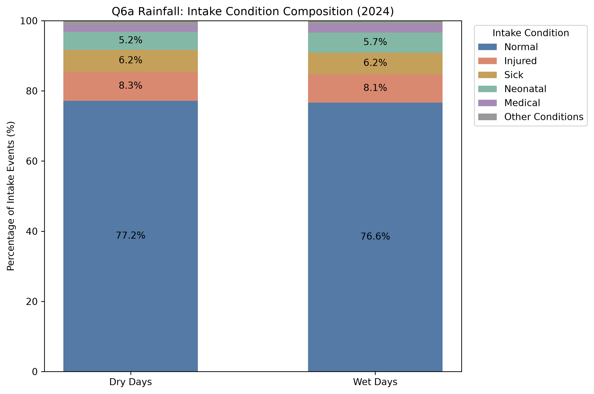

**Figure 6b. Wet-Minus-Dry Differences in Intake Condition Shares (2024)**

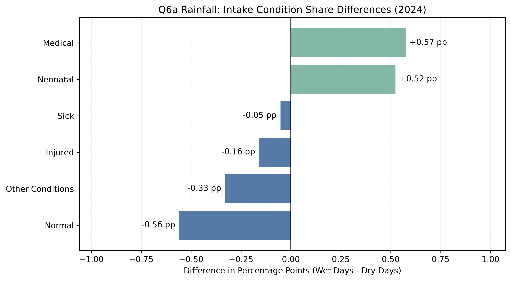

**Interpretation**

Rainfall is associated with relatively modest differences in recorded intake condition composition.

Although the shares of `Neonatal` and `Medical` conditions are somewhat higher on wet days, the descriptive comparisons do not indicate a substantial shift toward `Injured` or `Sick` classifications.

The results should not be interpreted as evidence that rainfall has no effect on animal health, since the analysis does not examine delayed weather effects, severity of conditions, or unrecorded animal experiences.

#### Q6b: Extreme Heat and Intake Condition Composition

The extreme heat comparison includes 8,585 intake events on non-hot days and 3,230 events on hot days.

| Intake Condition | Non-Hot Share | Hot Share | Hot − Non-Hot (pp) |
|---|---:|---:|---:|
| Normal | 78.75% | 72.63% | −6.12 |
| Injured | 7.96% | 8.95% | +0.99 |
| Sick | 5.51% | 8.05% | +2.54 |
| Neonatal | 4.67% | 6.97% | +2.30 |
| Medical | 1.76% | 2.32% | +0.56 |

Extreme heat is associated with more pronounced differences in recorded intake condition composition than rainfall.

The `Normal` share decreases from approximately 78.75% on non-hot days to 72.63% on hot days, a difference of −6.12 percentage points.

Meanwhile, the `Sick` share rises from 5.51% to 8.05%, an increase of approximately +2.54 percentage points.

The `Neonatal` share also increases, from 4.67% to 6.97%, representing a difference of approximately +2.30 percentage points.

The `Injured` and `Medical` categories exhibit smaller positive differences of approximately +0.99 and +0.56 percentage points, respectively.

**Figure 6c. Intake Condition Composition on Hot and Non-Hot Days (2024)**

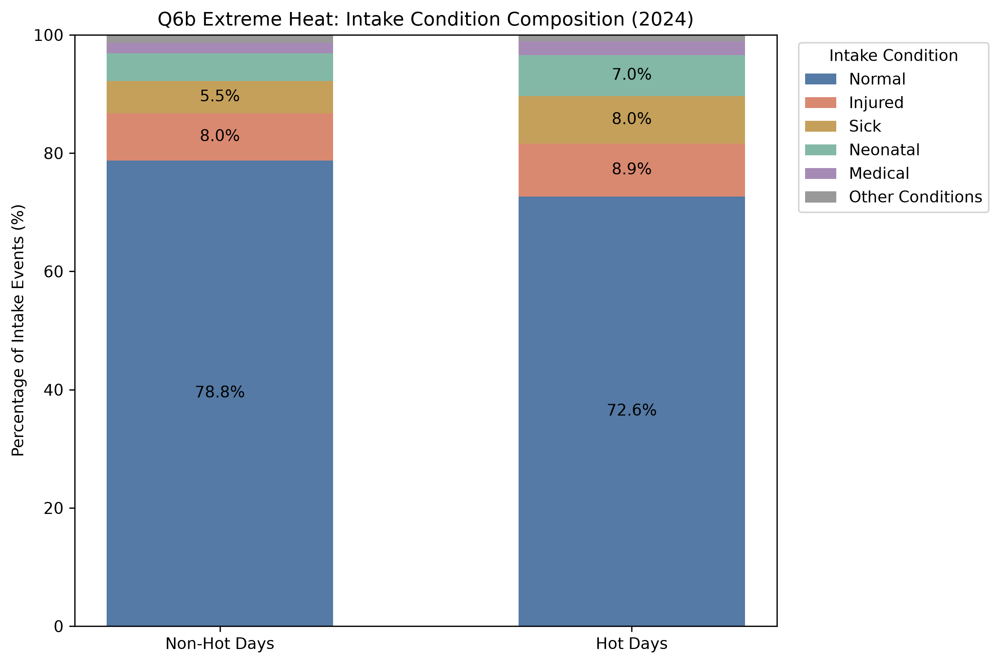

**Figure 6d. Hot-Minus-Non-Hot Differences in Intake Condition Shares (2024)**

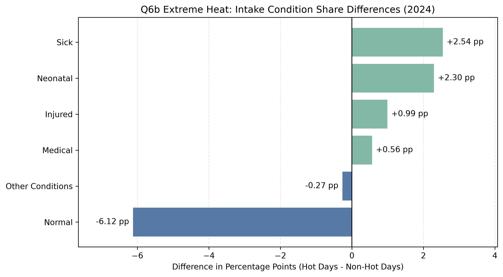

**Interpretation**

Among the weather comparisons examined in Q6, extreme heat reveals one of the clearest descriptive shifts in intake condition composition.

Compared with non-hot days, hot days are characterized by a smaller proportion of `Normal` intake events and larger proportions of `Sick`, `Neonatal`, `Injured`, and `Medical` events.

However, these differences do not establish that high temperatures directly cause animals to become sick or injured.

In particular, the higher `Neonatal` share may reflect seasonal differences in animal births and shelter intake patterns. Since hot days are concentrated in warmer months, seasonal variation may contribute to the observed association.

Furthermore, a higher share of a particular condition does not necessarily imply a higher absolute daily number of such intake events.

#### Q6c: Cold Weather and Intake Condition Composition

For the main cold-weather analysis, a cold day is defined as a day with a minimum temperature at or below 5°C.

The analysis includes 11,107 intake events on non-cold days and 708 events on cold days. The cold group covers 29 calendar days.

| Intake Condition | Non-Cold Share | Cold Share | Cold − Non-Cold (pp) |
|---|---:|---:|---:|
| Normal | 76.90% | 79.94% | +3.05 |
| Injured | 8.14% | 9.60% | +1.47 |
| Sick | 6.34% | 4.10% | −2.24 |
| Neonatal | 5.53% | 1.69% | −3.83 |
| Medical | 1.87% | 2.54% | +0.67 |

The cold-weather comparison reveals a different pattern from the extreme heat comparison.

The `Normal` share is approximately 3.05 percentage points higher on cold days.

The `Injured` share is also higher, increasing from approximately 8.14% to 9.60%.

In contrast, the `Sick` share decreases by approximately 2.24 percentage points, while the `Neonatal` share decreases by approximately 3.83 percentage points.

The `Medical` category shows a smaller positive difference of approximately 0.67 percentage points.

**Figure 6e. Intake Condition Composition on Cold and Non-Cold Days (2024)**

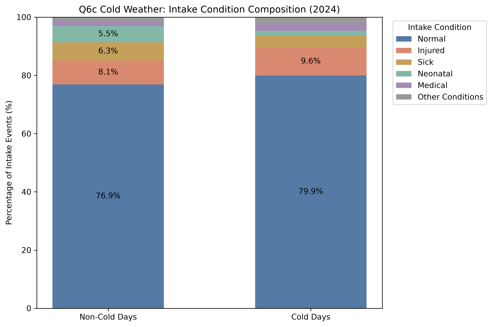

**Figure 6f. Cold-Minus-Non-Cold Differences in Intake Condition Shares (2024)**

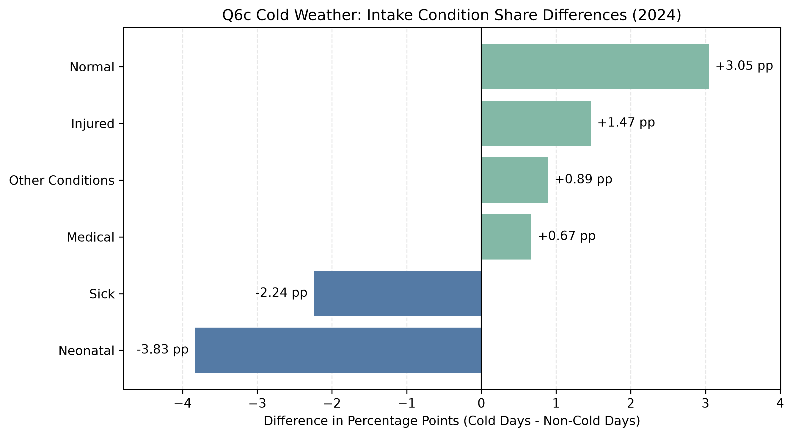

**Interpretation**

Cold days are associated with a higher relative share of `Normal` and `Injured` intake classifications, but lower shares of `Sick` and `Neonatal` classifications.

The decrease in the `Neonatal` share is particularly notable when compared with the higher neonatal share observed on hot days.

This contrast may partly reflect the seasonality of neonatal animal intakes rather than the immediate physiological effects of temperature.

The cold-day sample is substantially smaller than the non-cold sample, so these descriptive differences should be interpreted cautiously.

#### Q6c Sensitivity Analysis: Freezing Weather

To investigate whether the main cold-weather findings depend on the selected temperature threshold, we repeat the comparison using a stricter definition of freezing weather.

A freezing day is defined as a day with a minimum temperature at or below 0°C.

The sample contains 180 intake events recorded on seven freezing days and 11,635 intake events recorded on non-freezing days.

| Intake Condition | Non-Freezing Share | Freezing Share | Freezing − Non-Freezing (pp) |
|---|---:|---:|---:|
| Normal | 77.00% | 82.22% | +5.22 |
| Injured | 8.18% | 11.11% | +2.93 |
| Sick | 6.26% | 2.78% | −3.48 |
| Neonatal | 5.35% | 2.22% | −3.12 |
| Medical | 1.93% | 1.11% | −0.81 |

The freezing-day comparison preserves the directions of several key differences from the main 5°C cold-weather analysis.

The `Normal` share is approximately 5.22 percentage points higher on freezing days, while the `Injured` share is approximately 2.93 percentage points higher.

The `Sick` and `Neonatal` shares are lower by approximately 3.48 and 3.12 percentage points, respectively.

However, the `Medical` category changes direction: its share is slightly higher under the 5°C definition but lower under the 0°C definition.

**Figure 6g. Intake Condition Composition on Freezing and Non-Freezing Days (2024)**

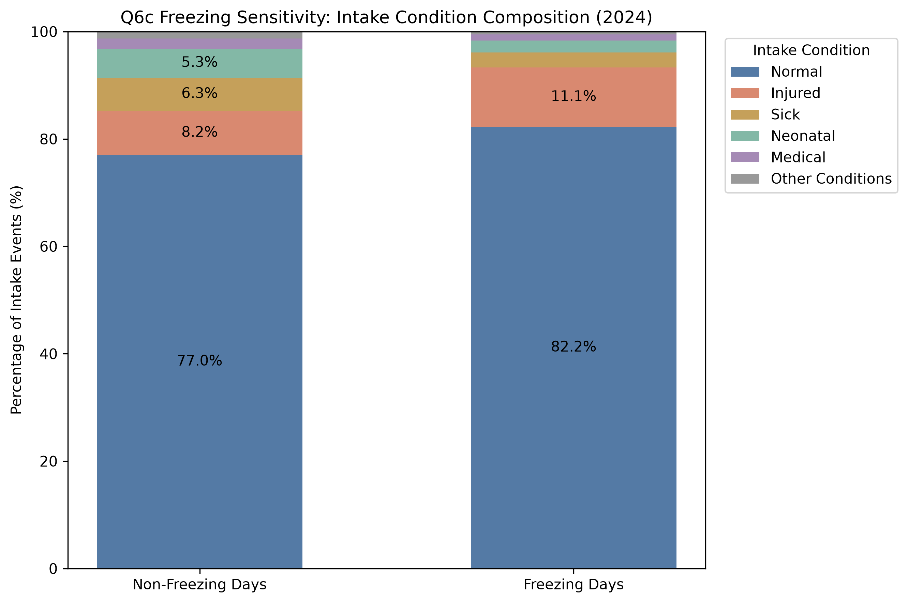

**Figure 6h. Freezing-Minus-Non-Freezing Differences in Intake Condition Shares (2024)**

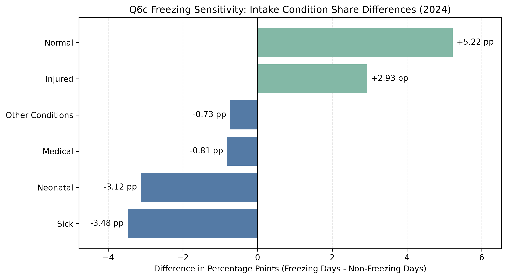

**Sensitivity Analysis Interpretation**

The findings for `Normal`, `Injured`, `Sick`, and `Neonatal` are directionally consistent across the 5°C and 0°C cold-weather definitions.

Nevertheless, the magnitudes of the differences vary, and the `Medical` category does not preserve the same directional pattern.

Importantly, the freezing-day comparison is based on only seven calendar days and 180 intake events. Consequently, the estimates may be sensitive to unusual daily circumstances, seasonal patterns, and the relatively small exposed sample.

This sensitivity analysis provides a useful robustness check for the descriptive direction of selected findings but does not establish statistical robustness or causal relationships.

### Overall Interpretation

Q6 reveals that the composition of recorded animal intake conditions differs across weather categories, but the patterns vary considerably depending on the weather condition examined.

Rainfall is associated with relatively small compositional differences, while extreme heat is associated with lower `Normal` shares and higher `Sick` and `Neonatal` shares.

Cold-weather comparisons exhibit a contrasting pattern: the shares of `Sick` and `Neonatal` intakes are lower, while `Injured` and `Normal` shares are higher.

These differences demonstrate the importance of examining specific intake condition categories rather than relying exclusively on the total number of animal intake events.

The findings also suggest that weather-related patterns in shelter records may reflect a combination of animal characteristics, seasonal variation, reporting behavior, and shelter operations.

The analysis is descriptive and does not identify the independent causal impact of weather conditions on animal health.

### Limitations

Several limitations should be considered when interpreting Q6.

First, the analysis uses recorded shelter intake events rather than a representative sample of all animals in Austin. Animals that never enter the shelter are not observed.

Second, `Intake Condition` is an administrative classification recorded when an animal enters the shelter. Categories such as `Sick`, `Injured`, and `Medical` do not necessarily represent comparable clinical diagnoses or levels of medical severity.

Third, an animal may contribute more than one intake event to the dataset. Therefore, the observations do not necessarily represent unique animals or statistically independent events.

Fourth, weather is matched to the date of recorded intake. The animal's condition may have developed before that date, meaning that same-day weather may not correspond to the relevant period of exposure.

Fifth, the analysis does not control for seasonality, animal type, weekdays, holidays, neighborhood characteristics, or changes in shelter operations. These factors may contribute to the observed differences.

Sixth, the weather indicators summarize daily conditions and may not capture the actual environmental exposure of each animal. Weather measurements represent the broader Austin area rather than each animal's precise location and intake time.

Seventh, the cold and freezing samples are relatively small. The freezing comparison in particular includes only seven days and 180 intake events, making the corresponding proportions sensitive to individual observations and daily variation.

Eighth, condition categories are mutually exclusive administrative labels. A higher share of one category necessarily affects the relative shares of other categories, even without changes in their absolute counts.

Finally, the results have not been subjected to formal statistical significance testing or causal identification. Observed percentage-point differences should therefore not be interpreted as statistically significant weather effects.

### Possible Extensions

Future research could extend this analysis in several directions.

First, separating dogs and cats may reveal whether weather-related intake condition patterns differ across animal types.

Second, examining intake counts by condition, in addition to condition proportions, would help distinguish changes in the volume of affected intake events from changes in their relative composition.

Third, using multi-year data could increase the sample size for rare cold-weather events and help determine whether the patterns persist across years.

Fourth, regression models incorporating month, season, weekdays, and other relevant characteristics could help assess whether the descriptive differences remain after accounting for observable confounding factors.

Fifth, analyzing lagged weather conditions could provide a more informative comparison between animal health classifications and the timing of potential environmental exposure.

Sixth, richer medical records or standardized clinical assessments would be needed to evaluate actual injury severity, illness diagnoses, and health outcomes more accurately.

Finally, linking intake and outcome histories at the individual-animal level could help investigate whether recorded health conditions at intake are associated with subsequent adoption, transfer, treatment, or length of shelter stay.

### Reproducibility

All Q6 analyses are implemented in:

`code/weather_analysis/analyze_intake_conditions.py`

From the project root directory, run:

```bash
python3 code/weather_analysis/analyze_intake_conditions.py
```

The script reads the following processed datasets:

- `data/processed/aac_intakes_clean.csv`
- `data/processed/austin_weather_2024.csv`

The script validates that all 11,815 intake events are retained, the original 16 intake condition categories are preserved, no intake conditions are missing, and all intake events are successfully matched to weather observations.

It produces eight CSV tables:

- `artifacts/weather_analysis/tables/q6a_rainfall_composition.csv`
- `artifacts/weather_analysis/tables/q6a_rainfall_differences.csv`
- `artifacts/weather_analysis/tables/q6b_heat_composition.csv`
- `artifacts/weather_analysis/tables/q6b_heat_differences.csv`
- `artifacts/weather_analysis/tables/q6c_cold_composition.csv`
- `artifacts/weather_analysis/tables/q6c_cold_differences.csv`
- `artifacts/weather_analysis/tables/q6c_freezing_sensitivity_composition.csv`
- `artifacts/weather_analysis/tables/q6c_freezing_sensitivity_differences.csv`

It also produces eight figures in:

`artifacts/weather_analysis/figures/06_intake_condition/`

The figure files are:

- `q6a_rainfall_composition.png`
- `q6a_rainfall_differences.png`
- `q6b_heat_composition.png`
- `q6b_heat_differences.png`
- `q6c_cold_composition.png`
- `q6c_cold_differences.png`
- `q6c_freezing_sensitivity_composition.png`
- `q6c_freezing_sensitivity_differences.png`

All input and output paths are resolved relative to the project directory. The analysis generates the statistics and figures programmatically without requiring manual modifications to the datasets.

The required Python packages are listed in the project's root `requirements.txt` file.


## Research Question 7: Outcome Type Composition Across Weather Conditions

### Research Objectives

The preceding analyses examine how weather conditions are associated with animal intake counts, intake types, intake conditions, and adoption outcome proportions.

However, focusing only on adoption outcomes may conceal changes in other types of shelter exits.

To investigate this possibility, Q7 examines the complete distribution of recorded outcome types under different weather conditions.

Four related comparisons are conducted:

- **Q7a:** Does the composition of animal outcome types differ between dry and wet days?
- **Q7b:** Does the composition of animal outcome types differ between hot and non-hot days?
- **Q7c:** Does the composition of animal outcome types differ between cold and non-cold days?
- **Q7c Sensitivity Analysis:** Are the cold-weather patterns similar when a stricter freezing-day threshold is used?

These comparisons extend Q3 by examining the full outcome distribution rather than adoption outcomes alone. They also parallel the intake type and intake condition composition analyses in Q5 and Q6.

### Data and Methodology

We use the same cleaned Austin Animal Center (AAC) outcome dataset and processed daily Austin weather dataset used in the preceding analyses.

The input datasets are:

- `data/processed/aac_outcomes_clean.csv`
- `data/processed/austin_weather_2024.csv`

The cleaned outcome dataset contains **11,822 outcome events** recorded in 2024.

Of these events, ten have missing values in the `Outcome Type` column and are excluded from the analysis.

The remaining **11,812 valid outcome events** are successfully matched to daily weather observations using their outcome dates. No valid outcome events remain unmatched.

#### Outcome Type Classification

The analysis retains all nine non-missing outcome type categories:

1. `Adoption`
2. `Transfer`
3. `Return to Owner`
4. `Euthanasia`
5. `Died`
6. `Rto-Adopt`
7. `Disposal`
8. `Missing`
9. `Lost`

The category `Missing` is a recorded outcome type and is distinct from an actual missing value (`NaN`) in the dataset.

Consistent with Q3, `Rto-Adopt` remains separate from `Adoption`.

No outcome categories are discarded from the statistical comparisons after excluding the ten records with missing outcome classifications.

#### Weather Classifications

Four weather comparisons are conducted.

**Q7a — Rainfall**

- Dry days: daily precipitation equals 0 mm.
- Wet days: daily precipitation exceeds 0 mm.

**Q7b — Extreme Heat**

- Hot days: daily maximum temperature is at least 35°C.
- Non-hot days: daily maximum temperature is below 35°C.

**Q7c — Cold Weather**

- Cold days: daily minimum temperature is at most 5°C.
- Non-cold days: daily minimum temperature exceeds 5°C.

**Q7c Sensitivity Analysis — Freezing Weather**

- Freezing days: daily minimum temperature is at most 0°C.
- Non-freezing days: daily minimum temperature exceeds 0°C.

The 5°C threshold is used for the main cold-weather comparison because the stricter 0°C threshold produces a substantially smaller sample.

#### Analytical Method

Individual outcome events are matched to the weather conditions recorded on their outcome dates.

For each weather group, the total number of valid outcome events is calculated.

We then count the events belonging to each outcome type and calculate their proportions:

**Outcome type proportion = (Outcome events of a given type / Total valid outcome events in the weather group) × 100%.**

For each outcome category, we also calculate the percentage-point difference between the exposed and reference weather groups.

The differences are defined as:

- Q7a: Wet minus Dry.
- Q7b: Hot minus Non-Hot.
- Q7c: Cold minus Non-Cold.
- Sensitivity analysis: Freezing minus Non-Freezing.

Each comparison uses the same 11,812 valid outcome events, partitioned according to its respective weather indicator.

The analysis is descriptive. It compares the composition of recorded outcome events and does not estimate causal effects or individual animals' probabilities of adoption.

### Findings

#### Q7a: Rainfall and Outcome Type Composition

The rainfall comparison includes **9,437 outcome events on dry days** and **2,375 outcome events on wet days**.

| Outcome Type | Dry Events | Dry Share | Wet Events | Wet Share | Wet − Dry (pp) |
|---|---:|---:|---:|---:|---:|
| Adoption | 5,914 | 62.67% | 1,517 | 63.87% | +1.21 |
| Transfer | 2,096 | 22.21% | 524 | 22.06% | −0.15 |
| Return to Owner | 664 | 7.04% | 170 | 7.16% | +0.12 |
| Euthanasia | 466 | 4.94% | 100 | 4.21% | −0.73 |
| Died | 123 | 1.30% | 26 | 1.09% | −0.21 |
| Rto-Adopt | 100 | 1.06% | 25 | 1.05% | −0.01 |
| Disposal | 66 | 0.70% | 12 | 0.51% | −0.19 |
| Missing | 6 | 0.06% | 1 | 0.04% | −0.02 |
| Lost | 2 | 0.02% | 0 | 0.00% | −0.02 |
| **Total** | **9,437** | **100.00%** | **2,375** | **100.00%** | **0.00** |

*Note: Percentages and percentage-point differences are rounded to two decimal places.*

The overall outcome type distribution is broadly similar on dry and wet days.

Adoption accounts for approximately **62.67%** of valid outcome events on dry days and **63.87%** on wet days, a wet-minus-dry difference of approximately **+1.21 percentage points**.

Euthanasia represents a slightly smaller proportion on wet days, decreasing from **4.94%** to **4.21%**, a difference of approximately **−0.73 percentage points**.

Transfer and Return to Owner exhibit relatively small changes.

The remaining categories also show limited differences, although their smaller event counts require cautious interpretation.

**Figure 7a. Outcome Type Composition on Dry and Wet Days (2024)**


Figure 7a compares the outcome type distributions on dry and wet days.

Adoption remains the dominant recorded outcome type in both groups, followed by Transfer and Return to Owner.

The broad similarity between the two distributions suggests that rainfall is associated with relatively modest differences in recorded outcome composition.

**Figure 7b. Wet-Minus-Dry Differences in Outcome Type Shares (2024)**

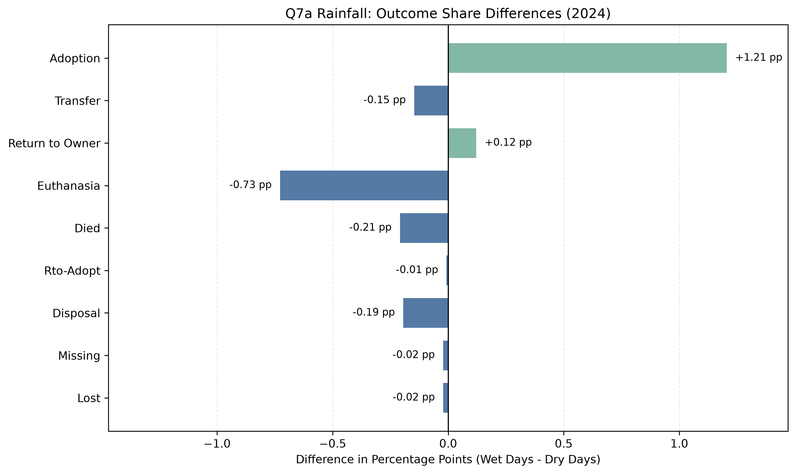

Figure 7b presents the percentage-point differences between wet and dry days.

Positive values indicate a larger outcome type share on wet days, while negative values indicate a smaller share.

The largest positive difference occurs in Adoption, while the most notable negative difference occurs in Euthanasia.

**Interpretation**

The results suggest that rainfall is associated with only small descriptive changes in AAC outcome composition.

The higher Adoption share on wet days does not necessarily imply that rainfall increases adoption activity or improves an individual animal's chances of adoption.

Instead, the result describes how adoption events are distributed relative to other recorded outcomes.

---

#### Q7b: Extreme Heat and Outcome Type Composition

The extreme-heat comparison includes **8,221 outcome events on non-hot days** and **3,591 outcome events on hot days**.

| Outcome Type | Non-Hot Events | Non-Hot Share | Hot Events | Hot Share | Hot − Non-Hot (pp) |
|---|---:|---:|---:|---:|---:|
| Adoption | 5,093 | 61.95% | 2,338 | 65.11% | +3.16 |
| Transfer | 1,878 | 22.84% | 742 | 20.66% | −2.18 |
| Return to Owner | 598 | 7.27% | 236 | 6.57% | −0.70 |
| Euthanasia | 405 | 4.93% | 161 | 4.48% | −0.44 |
| Died | 98 | 1.19% | 51 | 1.42% | +0.23 |
| Rto-Adopt | 99 | 1.20% | 26 | 0.72% | −0.48 |
| Disposal | 43 | 0.52% | 35 | 0.97% | +0.45 |
| Missing | 5 | 0.06% | 2 | 0.06% | −0.01 |
| Lost | 2 | 0.02% | 0 | 0.00% | −0.02 |
| **Total** | **8,221** | **100.00%** | **3,591** | **100.00%** | **0.00** |

*Note: Percentages and percentage-point differences are rounded to two decimal places.*

The extreme-heat comparison shows larger differences in outcome composition than the rainfall comparison.

The Adoption share increases from **61.95%** on non-hot days to **65.11%** on hot days, a difference of approximately **+3.16 percentage points**.

In contrast, the Transfer share decreases from **22.84%** to **20.66%**, a difference of approximately **−2.18 percentage points**.

Return to Owner and Euthanasia also represent somewhat smaller shares on hot days.

Disposal and Died represent slightly larger shares, although their changes are relatively small and should not be interpreted as evidence of weather-induced mortality.

**Figure 7c. Outcome Type Composition on Hot and Non-Hot Days (2024)**


Figure 7c presents the complete outcome type distribution under hot and non-hot conditions.

Adoption remains the largest category under both weather conditions. However, it accounts for a larger share on hot days.

Transfer accounts for a correspondingly smaller share.

**Figure 7d. Hot-Minus-Non-Hot Differences in Outcome Type Shares (2024)**

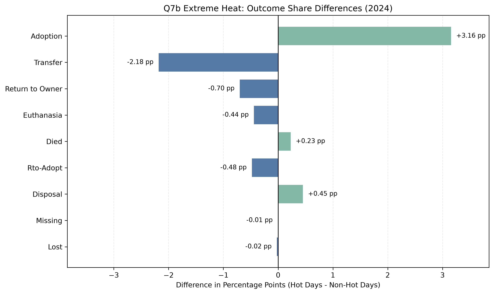

Figure 7d highlights the changes in outcome type shares associated with hot days.

The largest positive difference is observed in Adoption, while the largest negative difference is observed in Transfer.

**Interpretation**

These findings extend Q3 by showing that the higher overall Adoption share on hot days is accompanied by changes in other outcome categories, particularly a lower Transfer share.

Because the outcome categories collectively account for all valid outcome events, increases in the share of one category must be accompanied by decreases in the combined shares of other categories.

The observed differences should therefore be interpreted as changes in the relative composition of shelter outcomes rather than direct evidence that hot weather causes more adoptions or fewer transfers.

---

#### Q7c: Cold Weather and Outcome Type Composition

The main cold-weather comparison defines a cold day as one with a daily minimum temperature at or below 5°C.

The analysis includes **10,928 outcome events on non-cold days** and **884 outcome events on cold days**.

| Outcome Type | Non-Cold Events | Non-Cold Share | Cold Events | Cold Share | Cold − Non-Cold (pp) |
|---|---:|---:|---:|---:|---:|
| Adoption | 6,842 | 62.61% | 589 | 66.63% | +4.02 |
| Transfer | 2,470 | 22.60% | 150 | 16.97% | −5.63 |
| Return to Owner | 753 | 6.89% | 81 | 9.16% | +2.27 |
| Euthanasia | 532 | 4.87% | 34 | 3.85% | −1.02 |
| Died | 139 | 1.27% | 10 | 1.13% | −0.14 |
| Rto-Adopt | 111 | 1.02% | 14 | 1.58% | +0.57 |
| Disposal | 72 | 0.66% | 6 | 0.68% | +0.02 |
| Missing | 7 | 0.06% | 0 | 0.00% | −0.06 |
| Lost | 2 | 0.02% | 0 | 0.00% | −0.02 |
| **Total** | **10,928** | **100.00%** | **884** | **100.00%** | **0.00** |

*Note: Percentages and percentage-point differences are rounded to two decimal places.*

Cold weather is associated with more pronounced descriptive differences in outcome composition than rainfall or extreme heat.

Adoption accounts for **62.61%** of recorded outcomes on non-cold days and **66.63%** on cold days, representing an increase of approximately **+4.02 percentage points**.

Transfer shows the largest negative difference, declining from **22.60%** to **16.97%**, or approximately **−5.63 percentage points**.

Return to Owner increases from **6.89%** to **9.16%**, a difference of approximately **+2.27 percentage points**.

Euthanasia decreases by approximately **1.02 percentage points**, while the remaining categories show smaller differences.

**Figure 7e. Outcome Type Composition on Cold and Non-Cold Days (2024)**

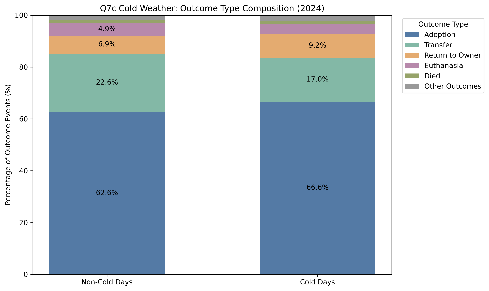

Figure 7e compares the complete outcome type distributions on cold and non-cold days.

The cold-day distribution contains relatively larger shares of Adoption and Return to Owner, together with a smaller Transfer share.

**Figure 7f. Cold-Minus-Non-Cold Differences in Outcome Type Shares (2024)**

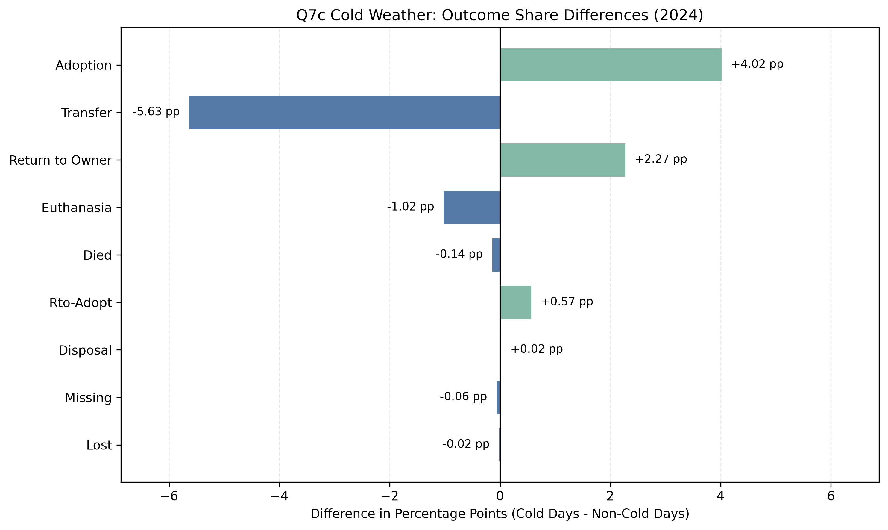

Figure 7f displays the percentage-point differences between cold and non-cold days.

Transfer exhibits the largest negative difference, while Adoption and Return to Owner exhibit the largest positive differences.

**Interpretation**

Compared with the rainfall and extreme-heat analyses, the cold-weather comparison reveals more substantial shifts in the distribution of recorded outcome types.

These differences may reflect seasonal changes, shelter operations, adoption opportunities, or other factors that coincide with colder weather.

Because the analysis does not control for these alternative explanations, the results should not be interpreted as causal weather effects.

---

#### Q7c Sensitivity Analysis: Freezing vs. Non-Freezing Days

To investigate the sensitivity of the cold-weather findings to the temperature threshold, we repeat the analysis using a stricter freezing-day definition.

A freezing day is defined as a day when the minimum temperature is at or below 0°C.

The comparison includes **11,627 valid outcome events on non-freezing days** and **185 valid outcome events on freezing days**.

| Outcome Type | Non-Freezing Events | Non-Freezing Share | Freezing Events | Freezing Share | Freezing − Non-Freezing (pp) |
|---|---:|---:|---:|---:|---:|
| Adoption | 7,303 | 62.81% | 128 | 69.19% | +6.38 |
| Transfer | 2,588 | 22.26% | 32 | 17.30% | −4.96 |
| Return to Owner | 817 | 7.03% | 17 | 9.19% | +2.16 |
| Euthanasia | 560 | 4.82% | 6 | 3.24% | −1.57 |
| Died | 149 | 1.28% | 0 | 0.00% | −1.28 |
| Rto-Adopt | 124 | 1.07% | 1 | 0.54% | −0.53 |
| Disposal | 77 | 0.66% | 1 | 0.54% | −0.12 |
| Missing | 7 | 0.06% | 0 | 0.00% | −0.06 |
| Lost | 2 | 0.02% | 0 | 0.00% | −0.02 |
| **Total** | **11,627** | **100.00%** | **185** | **100.00%** | **0.00** |

*Note: Percentages and percentage-point differences are rounded to two decimal places.*

The freezing-day comparison produces several patterns that are consistent with the main cold-weather analysis.

The Adoption share increases from **62.81%** on non-freezing days to **69.19%** on freezing days, a difference of approximately **+6.38 percentage points**.

Transfer decreases from **22.26%** to **17.30%**, a difference of approximately **−4.96 percentage points**.

Return to Owner increases by approximately **+2.16 percentage points**, while Euthanasia declines by approximately **−1.57 percentage points**.

These four categories exhibit the same directions of differences as in the main 5°C cold-weather comparison.

However, the magnitudes of the differences change under the stricter threshold, and not all smaller outcome categories retain the same direction.

**Figure 7g. Outcome Type Composition on Freezing and Non-Freezing Days (2024)**

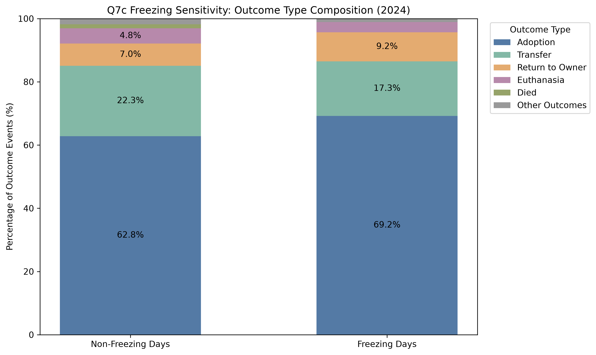

Figure 7g compares outcome type composition under the stricter freezing-day definition.

Adoption represents a larger share of outcomes on freezing days, while Transfer accounts for a smaller share.

**Figure 7h. Freezing-Minus-Non-Freezing Differences in Outcome Type Shares (2024)**

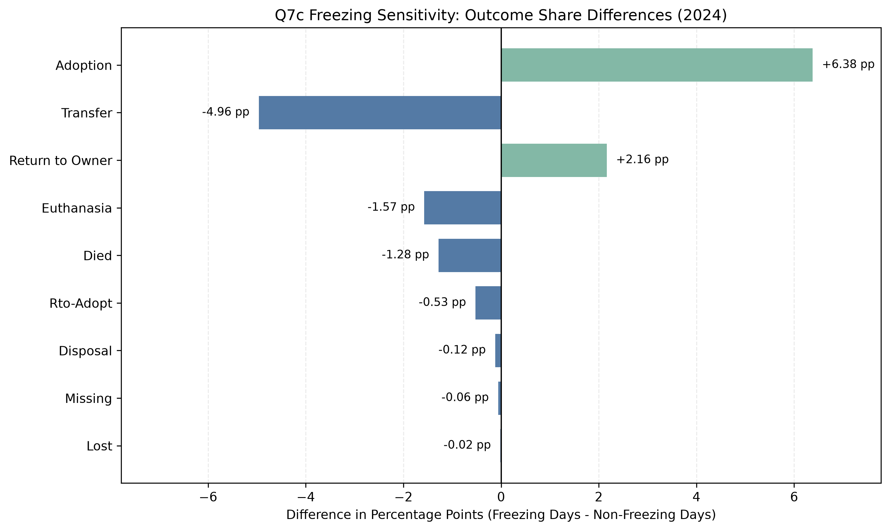

Figure 7h presents the percentage-point differences under the freezing-day definition.

The direction of the differences in Adoption, Transfer, and Return to Owner is consistent with the main cold-weather comparison.

**Sensitivity Analysis Interpretation**

The freezing-day results provide partial support for the descriptive patterns observed under the 5°C threshold.

However, the freezing-day group contains only **185 outcome events**, substantially fewer than the **884 events** in the main cold-day group.

Consequently, the observed proportions may be particularly sensitive to small changes in the number of recorded events.

The 0°C results should therefore be interpreted as a supplementary sensitivity analysis rather than as independent confirmation of a causal or statistically significant relationship.

---

### Overall Interpretation

Q7 examines whether the distribution of recorded AAC outcome types differs across weather conditions.

Three main findings emerge from the analysis.

First, **rainfall is associated with relatively small differences in outcome composition**. Adoption represents a slightly larger share of outcomes on wet days, while Euthanasia represents a slightly smaller share.

Second, **extreme heat is associated with a larger Adoption share and a smaller Transfer share**. These differences extend the original Q3 finding by showing how the distribution of non-adoption outcomes changes alongside the Adoption category.

Third, **cold weather is associated with the most pronounced descriptive differences among the three main comparisons**. Adoption and Return to Owner represent larger shares of outcomes on cold days, while Transfer represents a substantially smaller share.

The freezing-day sensitivity analysis shows broadly similar directional patterns for these major outcome categories, although the smaller sample size makes the estimates less stable.

Together, these findings demonstrate that examining adoption outcomes alone provides only a partial picture of weather-related variation in shelter outcome patterns.

By considering all recorded outcome types, Q7 provides a more complete description of how shelter exit composition varies across rainfall and temperature conditions.

Importantly, the direction and magnitude of the differences depend on the specific weather condition and outcome category being examined.

The results do not demonstrate that any weather condition directly causes a particular outcome.

### Limitations

Several limitations apply to the Q7 analysis.

First, all comparisons are descriptive. The analyses do not establish causal effects of rainfall, heat, or cold weather on animal outcomes.

Second, the unit of observation is a recorded outcome event rather than a unique animal. Animals may contribute multiple records over time, and outcome events recorded on the same date may be correlated.

Third, the analysis measures the composition of recorded outcome events. It does not measure the probability that an animal entering the shelter will eventually experience a particular outcome.

Fourth, differences in outcome composition may be influenced by seasonal patterns, weekdays, holidays, shelter staffing, shelter capacity, adoption programs, and other operational factors.

Fifth, the weather indicators simplify continuous weather conditions into binary categories. They do not directly measure temperature intensity, the duration of heat or cold events, or the effects of weather conditions on preceding days.

Sixth, the main cold-weather comparison contains fewer outcome events than the rainfall and extreme-heat comparisons. The stricter freezing-day comparison contains only 185 outcome events, so its estimates are especially sensitive to small changes in event counts.

Seventh, several outcome categories, including Lost, Missing, Disposal, and Rto-Adopt, have relatively small numbers of observations. Their percentage-point differences should be interpreted cautiously.

Eighth, the analysis excludes ten records with missing outcome types. The recorded category `Missing` is retained because it is an explicit category in the dataset rather than a null value.

Finally, the analysis does not conduct formal statistical significance tests or account for multiple comparisons across outcome categories and weather conditions.

Therefore, the observed percentage-point differences should not be interpreted as evidence of statistically significant weather effects.

### Possible Extensions

Future research could examine whether the observed outcome composition differences persist after accounting for seasonality, weekdays, holidays, and shelter operational factors.

Using a longer time series covering multiple years could also help determine whether the patterns observed in 2024 are persistent.

Additional analyses could investigate continuous temperature and precipitation measures rather than relying exclusively on binary weather classifications.

Lagged weather measures could be incorporated to examine whether shelter outcomes are associated with weather conditions during preceding days.

Animal-level characteristics, including age, species, health condition, and previous shelter histories, could provide additional insight into differences in recorded outcome patterns.

Finally, linking individual intake and outcome records could support analyses of time to adoption, transfer, or other outcomes. This would allow future research to investigate animal-level outcome probabilities rather than relying solely on the composition of recorded outcome events.

### Reproducibility

All Q7 analyses are implemented in:

`code/weather_analysis/analyze_outcome_type_composition.py`

From the project root directory, run:

```bash
python3 code/weather_analysis/analyze_outcome_type_composition.py
```

The script reads the following processed datasets:

- `data/processed/aac_outcomes_clean.csv`
- `data/processed/austin_weather_2024.csv`

The script validates the outcome event counts, excludes ten records with missing outcome types, matches all valid outcome events to daily weather observations, and computes the outcome type distributions under four weather comparisons.

It produces eight summary tables:

- `artifacts/weather_analysis/tables/q7a_rainfall_composition.csv`
- `artifacts/weather_analysis/tables/q7a_rainfall_differences.csv`
- `artifacts/weather_analysis/tables/q7b_heat_composition.csv`
- `artifacts/weather_analysis/tables/q7b_heat_differences.csv`
- `artifacts/weather_analysis/tables/q7c_cold_composition.csv`
- `artifacts/weather_analysis/tables/q7c_cold_differences.csv`
- `artifacts/weather_analysis/tables/q7c_freezing_sensitivity_composition.csv`
- `artifacts/weather_analysis/tables/q7c_freezing_sensitivity_differences.csv`

It also produces eight figures:

- `artifacts/weather_analysis/figures/07_outcome_type/q7a_rainfall_composition.png`
- `artifacts/weather_analysis/figures/07_outcome_type/q7a_rainfall_differences.png`
- `artifacts/weather_analysis/figures/07_outcome_type/q7b_heat_composition.png`
- `artifacts/weather_analysis/figures/07_outcome_type/q7b_heat_differences.png`
- `artifacts/weather_analysis/figures/07_outcome_type/q7c_cold_composition.png`
- `artifacts/weather_analysis/figures/07_outcome_type/q7c_cold_differences.png`
- `artifacts/weather_analysis/figures/07_outcome_type/q7c_freezing_sensitivity_composition.png`
- `artifacts/weather_analysis/figures/07_outcome_type/q7c_freezing_sensitivity_differences.png`

The analysis uses project-relative paths and generates all statistics, tables, and figures programmatically.

Required Python packages are listed in the project's root `requirements.txt` file.


